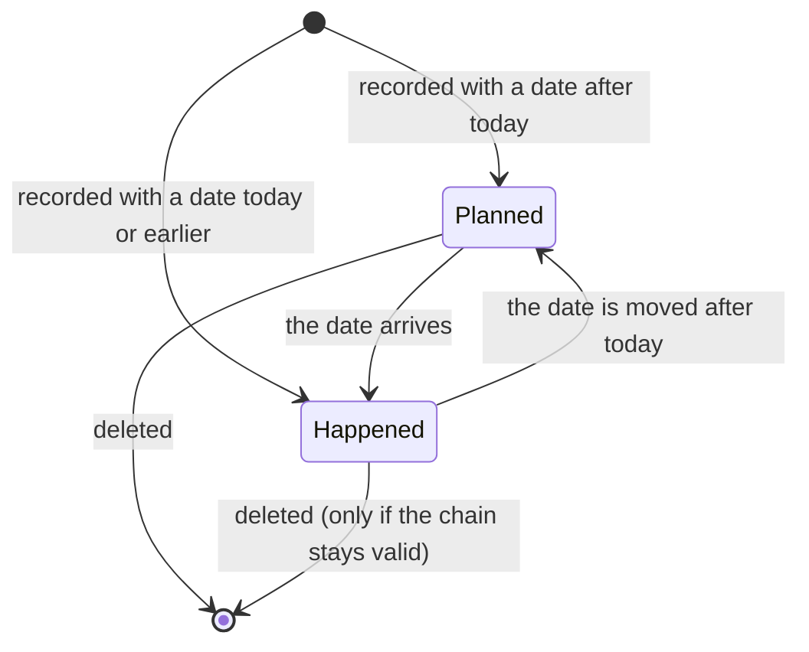
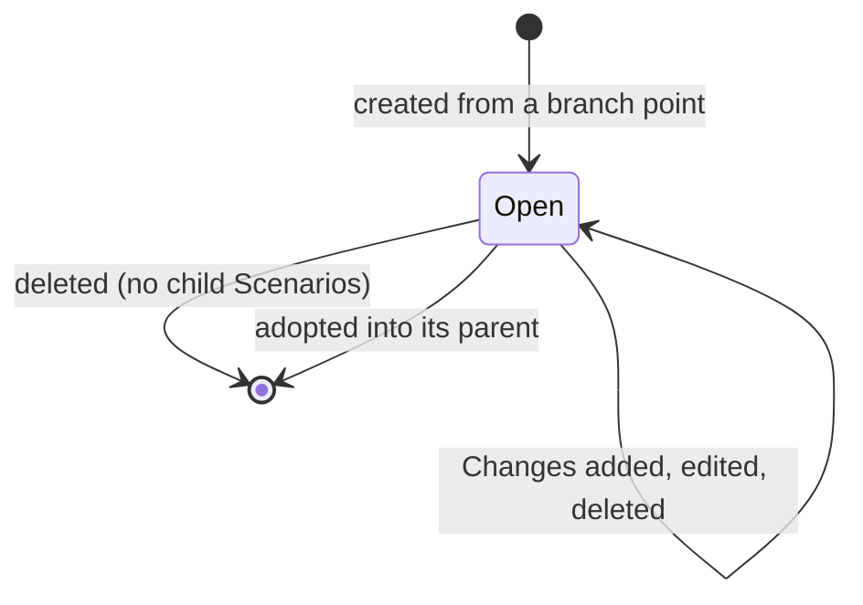

# Domain model: Model timeline

Status: accepted

## Purpose and boundary

Settles what a line, a change, a state, an edit and a Scenario are, how a state is computed, when a change
is valid, and who may do what. It does not decide the tables, routes or screens (see
`technical-design.md`), the Metamodel (ADR-0043), or how metrics evolve over time.

## Concepts

| Concept | Definition |
| --- | --- |
| **Model** | An Organization's description of itself: a Metamodel plus lines (unchanged otherwise). |
| **Line** | An ordered history of changes belonging to one Model. A line is either the Base line or a Scenario. |
| **Base line** | The one line per Model that records what has really happened to the company. Nameable, never deleted. Its present state is the company's present state. |
| **Scenario** | Any other line: a what-if with a name, a parent line and a branch point, and changes of its own. |
| **Branch point** | A change of the parent line. A Scenario starts from the state after that change. It refers to the change; it is not a copy. |
| **Change** | A dated set of edits in one line: a title, an optional note, a mandatory date, and an ordered list of edits. |
| **Edit** | One step inside a Change on one element: add node, remove node, update node, add connection, remove connection, re-route connection, change connection type. Elements are identified by stable ids. |
| **Planned change** | A change dated after today in the Organization's time zone. It is an ordinary change that has not yet "happened"; it becomes part of the present state when its date arrives. |
| **Start** | The fixed first row of a Scenario's change list: the parent line's state at the Scenario's branch point. It is not a Change, is read-only and counts for nothing. |
| **State** | The graph (nodes, connections, with their types) after one change of one line. |
| **Present state** | The state after the last change dated today or earlier on a line. |
| **Chain** | The sequence of changes a state is computed from: the changes of every ancestor line up to its branch point, then the line's own changes up to the chosen change. |
| **Position** | Where a node is drawn. A property of the drawing per line, not a change. |
| **Adopt** | Appending a Scenario's own changes to its parent line when the parent has not moved on since the branch point. |
| **Metamodel** | Node types, connection types and allowed connections of the Model; shared by all lines. |

## Aggregate and ownership

- The **Model** is the aggregate root. Lines, Changes, Edits and positions belong to it and carry
  the Organization's id.
- A write to a line locks the Model for the duration of the validation and the save, because the
  validity of one change depends on every other change in the chain and in dependent lines.
- Metrics, metric values, simulations and analyses belong to a line (they belonged to a version).
- A change is owned by the line it is in. Deleting a line deletes its changes; deleting a Change
  deletes its Edits.

## Lifecycle

A change's state is computed from its date and today; it is never stored. A Scenario lives until it is
deleted or adopted:

## Business rules

1. Every Model has exactly one Base line, created with the Model, with one change "Initial situation"
   that starts empty and dated the creation day. The Base line cannot be deleted; it can be renamed.
2. A change always has a date. Changes sort by date, then by entry order. There is no manual order.
3. The state after change E is the replay of its chain in order. A change that refers to an element that
   does not exist at that point, or adds an element that already exists, makes the chain invalid. Removing
   a node removes the connections attached to it in the same step.
4. A change is valid only if its types exist in the Metamodel, the Metamodel allows the connection
   between the two node types, both endpoints exist and differ, and no duplicate connection of the same
   type between the same ends results (as today).
5. A Scenario's branch point is a change of its parent. Its own changes are dated on or after the branch
   change's date. Changes inserted into the parent before the branch point change the Scenario's start;
   changes after it never do.
6. Any write to a change (create, change, move in time, delete) is validated by replaying the chain
   of the changed line and of every line that branches from any of its changes, recursively. If any step
   is invalid, nothing is saved and the person is told which change and element would break, why, and what
   to change first.
7. A change that is another line's branch point cannot be deleted; the message names that line.
8. A line with child Scenarios cannot be deleted. The Base line cannot be deleted.
9. Only Owners and Admins write to the Base line. Members write to Scenarios. Reading needs only membership.
10. Planned changes are allowed in any line. Whether a change is planned is computed against today in the
    Organization's time zone.
11. Moving a node writes a position for that line and node, never a change. A position falls back to the
    parent line, then to the position the node was added with.
12. Creating a Scenario copies the parent's metrics and values (as a fork does today). A line's metrics,
    simulations and analyses are independent of other lines afterwards.
13. Adopt: allowed only if the parent has no changes after the branch point; the Scenario's changes keep
    their dates, none of which may precede the parent's last change; the chain check runs first; metrics
    are not adopted.
14. A node or connection type, or an allowed connection, that any change or branch still uses cannot be
    deleted (`in_use`).
15. A read-only Organization can read all lines and states but not write.
16. An agent has the rights of the person it acts for; its calls are logged (ADR-0047).

## Authorization matrix

| Action | Owner / Admin | Member | Read-only Organization |
| --- | --- | --- | --- |
| Read lines, changes, states | Allowed | Allowed | Allowed |
| Create a Scenario | Allowed | Allowed | Denied |
| Add, edit, delete Changes on the Base line | Allowed | Denied (403) | Denied |
| Add, edit, delete Changes on a Scenario | Allowed | Allowed | Denied |
| Rename the Base line | Allowed | Denied | Denied |
| Rename or delete a Scenario | Allowed | Own Scenarios; another's denied | Denied |
| Adopt a Scenario into the Base line | Allowed | Denied | Denied |
| Adopt a Scenario into another Scenario | Allowed | Allowed (own or editable) | Denied |
| Move nodes (positions) on a line | Allowed where they may write | Allowed on Scenarios | Denied |

## Consequences for specifications

- `PRD.md` takes its acceptance criteria from rules 1 to 16; `technical-design.md` turns rules 3 to 8 into
  the replay and validation design.
- ADR-0048 (changes on lines), ADR-0049 (chain validation) and ADR-0050 (adoption) record the decisions;
  `CONTEXT.md` gets the vocabulary and retires Version, Baseline, Change list and Merge.
- `.scratch/structure-canvas/` consumes only the state-after-change read and the change write; it does not
  know how changes are stored.
- Open: the owner's first-use experience when a Model has only the initial change, and whether the creator of
  a Scenario keeps a right over it after a role change (default: role at the time of writing decides).
