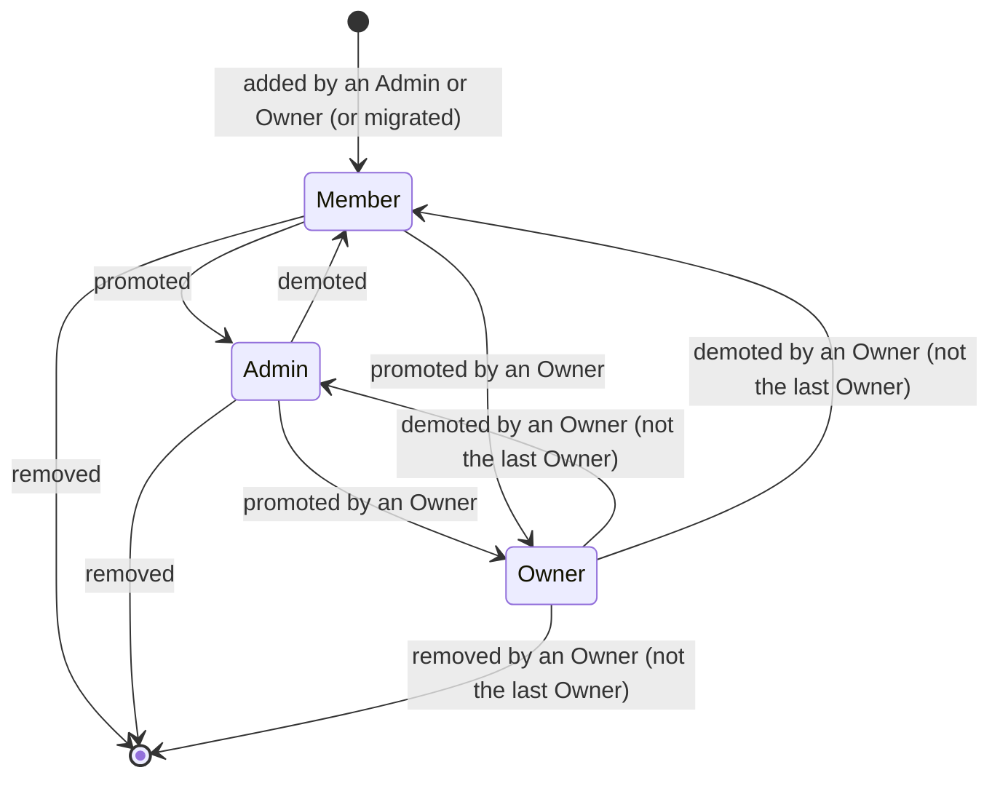

# Domain model: Companies (tenants) and roles

Status: ready-for-human

## Purpose and boundary

Fixes who may see and change what once several companies share Shadow: the ownership of data by a
company, a person's membership and role, and the rules for managing members. It builds on ADR-016
(names, roles, isolation). It does not select tables, routes or components, and it does not decide
invitations, billing or deletion (steps 5, 6, 8).

## Concepts

| Concept | Definition |
| --- | --- |
| **Tenant (Company)** | A subscribing company. Owns Organisations, Customers (with Contacts and Addresses), predictions, AI change sets and organisation-specific Metamodels. In this step it is always `active`. |
| **Membership** | A person's belonging to one company with one role. One person may have many memberships, at most one per company. |
| **Role** | `owner`, `admin` or `member` (ADR-016). Roles add up: an Owner may do what an Admin may, an Admin what a Member may. |
| **Account** | A `users` row of account class `customer` (ADR-016). Accounts exist independently of companies; a person with no membership has no access to any company. |
| **Tenant context** | The company and the person a database transaction acts for. Absent context sees no company data. |
| **Default Metamodel** | The Metamodel with no company: readable by every company, changed only by the reference-data seed, never through the application. |

## Aggregate and ownership

- A **company-owned row** belongs to exactly one company and cannot be moved. Child rows (a scenario's
  events, a prediction's points, a change set's operations) belong to their parent's company.
- **Membership** is changed only through the company's member management by an Admin or Owner of that
  company, by the operator, or by the migration. A person cannot give themselves a role.
- An Organisation's name is unique among the active Organisations of its company, not globally.
- Account data (email, name, sessions, identities) is not company data: it is visible to a company's
  Admins and Owners only through that company's member list (name, email, role).

## Lifecycle

A company in this step has one state, `active`; other states come with steps 5 and 8.

## Business rules

1. Every company-owned row has exactly one company; no row refers to a parent of another company.
2. A company always has at least one Owner who is an active (not deleted) account. Removing or demoting
   the last Owner is refused (409).
3. At most one membership per (company, person).
4. Only an Owner appoints an Owner, demotes or removes an Owner. Admins and Owners add, remove and
   change Members and Admins. Nobody may remove or demote themselves out of being the last Owner.
5. Adding a person by email normalizes the address (trimmed, lower case). An existing active customer
   account receives the membership; otherwise an account without identity is created and links on its
   first verified sign-in. A platform account is never added (404, as if absent).
6. An unknown company, a company the person does not belong to, and another company's Organisation or
   Customer all answer 404; a member who lacks the role for an action gets 403. The answers never
   reveal whether another company's object exists.
7. A person with no membership sees no company data and can only list their (empty) companies.
8. Removing a membership ends that person's access to the company at once (their next request fails);
   it does not delete the account or other memberships, and it revokes nothing else. Revoking a
   person's sessions is a separate Admin action.
9. Soft-deleting an account does not remove its memberships but the account no longer counts as an
   Owner for rule 2 and cannot sign in.
10. Creating an account at first sign-in (D4) gives it no membership, no role and no data.
11. Membership creation, role changes, removal and account creation at sign-in are audited with
    actor, company and target.

## Authorization matrix

| Action | Owner | Admin | Member | Non-member / no company |
| --- | --- | --- | --- | --- |
| List my companies | yes | yes | yes | yes (own, possibly empty) |
| Read Organisations, scenarios, states, structure, timeseries, predictions, Customers | yes | yes | yes | 404 |
| Change them, request predictions, stage and review AI change sets | yes | yes | yes | 404 |
| Use MCP as myself in a company I belong to | yes | yes | yes | 404 / error |
| List the company's members (name, email, role) | yes | yes | 403 | 404 |
| Add a person as Member or Admin | yes | yes | 403 | 404 |
| Add a person as Owner, promote to Owner | yes | 403 | 403 | 404 |
| Change a role between Member and Admin | yes | yes | 403 | 404 |
| Demote an Owner, remove an Owner | yes (not the last) | 403 | 403 | 404 |
| Remove a Member or an Admin | yes | yes | 403 | 404 |
| Revoke a member's sessions | yes | yes | 403 | 404 |
| Billing, ownership transfer, company deletion | later (steps 5, 6, 8) | | | |

## Consequences for specifications

- The PRD acceptance criteria follow rules 1, 2, 6 and 7; the technical design implements them as a
  per-request tenant context, row-level policies and the members API.
- ADR-016 stays as decided; its RLS paragraph is extended in ticket 10 with the mechanics (column
  defaults and triggers, session hook, worker scope).
- `CONTEXT.md` moves Tenant/Company, Membership and Role to *Language* in ticket 01;
  `docs/architecture/domains/TENANTS.md` and `concepts/` documents are created in ticket 01 and
  extended by the later tickets.
