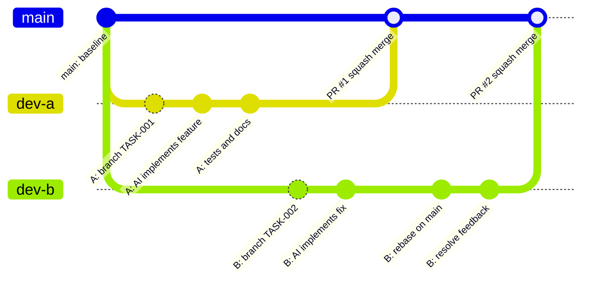

# AI-First Engineering Handbook

Version: 1.1 (May 2026)

Tämä dokumentti on projektin ensisijainen kehityskäsikirja ihmisille ja AI-agenteille.

Se määrittelee:

- AI-agenttien toimintatavat
- kehitysprosessin
- Pull Request -käytännöt
- review-prosessin
- dokumentaatiomallin
- arkkitehtuuripäätökset
- Definition of Done -säännöt

Projektin tarkempi nykytila kuvataan tiedostoissa `AGENTS.md` ja `ARCHITECTURE.md`.

---

# Philosophy

Projekti on AI-first.

Tavoitteena on:

- AI tuottaa suuren osan koodista
- ihmiset tekevät tuote-, arkkitehtuuri- ja tietoturvapäätökset
- arkkitehtuuri pysyy hallittuna
- muutokset ovat pieniä ja tarkastettavia
- dokumentaatio antaa agentille riittävän kontekstin ilman raskasta prosessia

Perussääntö:

```text
Issue -> Task -> AI Implementation -> AI Review -> Human Review -> PR -> Merge -> Deploy
```

---

# Repository Structure

```text
repo/
|
├── AGENTS.md
├── ARCHITECTURE.md
├── AI-FIRST-ENGINEERING-HANDBOOK.md
├── README.md
|
├── docs/
|   ├── AI-DEVELOPMENT-WORKFLOW.md
|   ├── LOCAL-DEVELOPMENT.md
|   └── decisions/
|       ├── ADR-001-*.md
|       ├── ADR-002-*.md
|       └── ...
|
├── tasks/
|   ├── TASK-TEMPLATE.md
|   ├── TASK-001-*.md
|   └── ...
|
├── frontend/
├── backend/
├── infra/
|
└── .github/
    ├── ISSUE_TEMPLATE/
    ├── workflows/
    └── PULL_REQUEST_TEMPLATE.md
```

Kaikkia hakemistoja ei tarvitse täyttää ennen kuin projekti tarvitsee niitä.

---

# Source Of Truth

AI-agentin tulee lukea lähteet tässä järjestyksessä:

1. `AGENTS.md`
2. `ARCHITECTURE.md`
3. `docs/decisions/*.md`
4. `tasks/*.md`
5. `README.md`

Jos dokumentit ovat ristiriidassa:

- ADR voittaa vanhemman toteutuksen.
- `ARCHITECTURE.md` voittaa `README.md`:n.
- Taskin scope voittaa yleisen toiveen, ellei task ole ristiriidassa arkkitehtuurin tai ADR:n kanssa.
- Jos vastausta ei löydy, kysy ihmiseltä päätös.

---

# Core Documents

## AGENTS.md

Projektin tärkein agenttikohtainen tiedosto.

Sisältää:

- projektin tarkoituksen
- nykyisen statuksen
- teknologiapinon tai `TBD`-tilan
- agenttisäännöt
- lähteiden lukujärjestyksen
- mitä AI saa ja ei saa tehdä

Kaikkien agenttien tulee lukea tämä ensin.

## ARCHITECTURE.md

Kuvaa järjestelmän nykyisen arkkitehtuurin.

Sen tarkoitus on vastata:

```text
Mihin tämä ominaisuus kuuluu?
```

Tiedosto ei ole roadmap. Se kuvaa päätettyä tai toteutettua nykytilaa.

## ADR Documents

Kaikki merkittävät päätökset dokumentoidaan tiedostoon `docs/decisions/ADR-XXX-*.md`.

ADR tarvitaan, kun:

- valitaan uusi teknologia
- muutetaan arkkitehtuuria
- vaihdetaan tietokantastrategiaa
- muutetaan deployment-mallia
- lisätään merkittävä uusi integraatio tai infrakomponentti

Ensimmäiset suositellut ADR:t:

```text
ADR-001-tech-stack.md
ADR-002-database.md
ADR-003-authentication.md
ADR-004-deployment.md
```

---

# Task Driven Development

Kaikki merkittävä työ alkaa taskista.

Pienessä projektissa GitHub Issue voi riittää, kun muutos on pieni ja yksiselitteinen. Erillinen `tasks/TASK-XXX-*.md` tarvitaan, kun työ:

- koskee useampaa moduulia
- muuttaa tietomallia
- lisää integraation
- vaikuttaa arkkitehtuuriin
- vaatii useita hyväksymiskriteerejä
- annetaan AI-agentille itsenäisesti toteutettavaksi

Task sisältää varsinaisen teknisen speksin. Issue toimii työnhallinnan ja keskustelun paikkana.

---

# Issue To Merge Workflow

## 1. Idea

Idea voi tulla ihmiseltä, käyttäjäpalautteesta, bugista tai teknisestä tarpeesta.

Tässä vaiheessa ei vielä tehdä koodia.

## 2. Create GitHub Issue

Issueen kirjataan:

- tavoite
- hyväksymiskriteerit
- mahdolliset tekniset huomiot
- linkki taskiin, jos task luodaan

Pienelle projektille riittää aluksi kaksi issue-templatea:

- Feature
- Bug

Muita templateja lisätään vasta kun niille on todellinen tarve.

## 3. Create Task Spec

Task luodaan tiedostoon:

```text
tasks/TASK-XXX-short-name.md
```

Taskissa määritellään:

- Goal
- Requirements
- Acceptance Criteria
- Out Of Scope
- Implementation Notes
- Testing
- Documentation

## 4. Scope Approval

Ihminen hyväksyy taskin scopin ennen toteutusta, jos työ on laaja, epäselvä tai vaikuttaa arkkitehtuuriin.

## 5. Create Branch

Kehittäjä luo oman branchin DEV-ympäristössä:

```bash
git checkout main
git pull origin main
git checkout -b feature/TASK-001-user-auth
```

Branch-nimi sisältää työn tyypin ja mielellään taskin numeron:

```text
feature/TASK-001-user-auth
fix/TASK-002-login-timeout
docs/TASK-003-agent-workflow
chore/TASK-004-ci-setup
refactor/TASK-005-auth-service
```

## 6. AI Implementation

AI-agentti:

- lukee `AGENTS.md`
- lukee `ARCHITECTURE.md`
- lukee relevantit ADR:t
- lukee taskin
- toteuttaa vain hyväksytyn scopin
- lisää tai päivittää testit
- päivittää dokumentaation tarvittaessa
- pitää muutokset pieninä

AI-agentti ei saa:

- muuttaa arkkitehtuuria ilman ADR:ää
- lisätä riippuvuuksia ilman hyväksyntää
- poistaa testejä
- commitoida salaisuuksia
- muuttaa tuotantoympäristöä
- mergata main-haaraan

## 7. Local Verification

Ennen pushia kehittäjä tai agentti ajaa projektin vaatimat tarkistukset.

Kun stack on valittu, minimikomentoja ovat tyypillisesti:

```bash
npm run lint
npm test
npm run build
```

Jos stack on vielä `TBD`, taskissa määritellään mitä voidaan tarkistaa.

## 8. Update Branch Before PR

Ennen PR:ää branch päivitetään mainin päälle:

```bash
git fetch origin
git rebase origin/main
```

Jos rebase ei ole tiimille tuttu, voidaan käyttää mergeä, mutta valitaan yksi tapa ja kirjataan se `CONTRIBUTING.md`:hen.

## 9. Push Branch

```bash
git push -u origin feature/TASK-001-user-auth
```

## 10. Open Pull Request

PR:ssä pitää näkyä:

- mitä tehtiin
- mihin issueen tai taskiin muutos liittyy
- mitkä hyväksymiskriteerit täyttyvät
- miten testattiin
- mitkä riskit tai rajaukset jäivät

## 11. Continuous Integration

Jokaisessa PR:ssä suoritetaan, kun sovelluksen stack on valittu:

```text
Install
Lint
Test
Build
```

Merge estetään, jos CI epäonnistuu.

## 12. AI Review

Ensimmäinen review voidaan tehdä AI-agentilla.

AI-review tarkistaa:

- vastaako muutos taskia
- onko regressioriskejä
- puuttuuko testejä
- onko tietoturvaongelmia
- onko dokumentaatio päivittämättä

## 13. Human Review

Ihminen tarkistaa:

- Scope: vastaako taskia
- Architecture: noudattaako `ARCHITECTURE.md`:tä
- Security: onko ratkaisu turvallinen
- Database: ovatko migraatiot järkeviä
- Maintainability: onko toteutus ylläpidettävä

## 14. Merge

Käytetään:

```text
Squash and Merge
```

Squash-commit noudattaa Conventional Commits -muotoa:

```text
feat(auth): implement login flow
fix(api): validate document upload input
docs(workflow): document AI-first PR process
```

## 15. Deploy

Kun deployment on päätetty ADR:ssä, merge mainiin käynnistää sovitun julkaisuprosessin.

Tyypillinen malli:

```text
main -> GitHub Actions -> Docker image -> staging -> production
```

Tuotantojulkaisu on ihmisen vastuulla.

## 16. Close Work

Työ suljetaan, kun:

- Issue sulkeutuu
- task merkitään valmiiksi
- dokumentaatio on ajan tasalla
- mahdollinen release/deploy on tarkistettu

---

# Developer Branch Workflow

Kaksi kehittäjää voi tehdä työtä rinnakkain omissa DEV-ympäristöissään:



Sama käytännössä:

```bash
git checkout main
git pull origin main
git checkout -b feature/TASK-001-user-auth

# toteutus AI-agentilla
# testit ja paikallinen tarkistus

git fetch origin
git rebase origin/main
git push -u origin feature/TASK-001-user-auth
```

---

# Pull Request Policy

Pakolliset ehdot:

- PR liittyy yhteen issueen tai taskiin.
- CI on vihreä, kun CI on käytössä.
- Hyväksymiskriteerit täyttyvät.
- Testit on lisätty tai puuttuminen perustellaan.
- Dokumentaatio on päivitetty tarvittaessa.
- Vähintään yksi hyväksyntä ennen mergeä.

Suositus:

- alle 500 riviä reviewattavaa muutosta
- yksi looginen muutos per PR

---

# Review Checklist

```markdown
## Scope

- [ ] Vastaa taskia
- [ ] Ei sisällä tarpeetonta lisäscopea

## Architecture

- [ ] Noudattaa ARCHITECTURE.md:tä
- [ ] Ei muuta arkkitehtuuria ilman ADR:ää

## Security

- [ ] Input validoitu
- [ ] Authorization tarkistettu backendissä
- [ ] Ei salaisuuksia
- [ ] Ei sensitiivistä dataa lokeissa

## Database

- [ ] Skeemamuutokset migraatioina
- [ ] Ei manuaalisia tuotantomuutoksia

## Testing

- [ ] Testit mukana
- [ ] Kriittiset polut katettu
- [ ] Testit ajettu

## Documentation

- [ ] Dokumentaatio päivitetty tarvittaessa
- [ ] ADR lisätty tarvittaessa
```

---

# Branch Policy

## Main

`main` on suojattu haara.

Säännöt:

- ei suoria pushauksia
- kaikki muutokset PR:n kautta
- CI:n pitää mennä läpi
- vähintään yksi approval
- stale approvalit mitätöidään uusien muutosten jälkeen

## Branch Naming

```text
feature/TASK-001-user-auth
fix/TASK-002-login-timeout
docs/TASK-003-workflow
chore/TASK-004-ci
refactor/TASK-005-auth-service
```

---

# Commit Policy

Käytetään Conventional Commits -mallia.

Esimerkkejä:

```text
feat(auth): add login endpoint
fix(auth): fix refresh token validation
docs(architecture): update deployment diagram
test(auth): add login tests
chore(ci): add pull request checks
```

Pidä commitit pieninä ja loogisina.

---

# CI/CD Policy

Kun sovelluksen stack on valittu, jokaisessa PR:ssä suoritetaan:

```text
Install
Lint
Test
Build
```

Suositeltu GitHub Actions -putki dokumentoidaan tiedostossa `.github/workflows/ci.yml`.

Jos projektissa ei vielä ole sovelluskoodia tai package manageria, CI saa olla kevyt dokumentaatiotarkistus. Varsinainen build/lint/test otetaan käyttöön heti, kun stack-päätös on tehty.

---

# Environment Variables

Älä koskaan commitoi:

```text
.env
.env.local
```

Repossa säilytetään vain:

```text
.env.example
```

Esimerkki:

```env
DATABASE_URL=
JWT_SECRET=
APP_URL=http://localhost:3000
```

Salaisuudet tallennetaan ympäristökohtaisiin secret-varastoihin, ei repositoryyn.

---

# Database Policy

Kaikki skeemamuutokset tehdään migraatioina ja versionhallitaan.

Kielletty:

```sql
ALTER TABLE production ...
```

manuaalisesti tuotantoympäristössä.

Kun ORM valitaan, migraatioiden generointi- ja ajokomennot dokumentoidaan `README.md`:ssä tai `docs/LOCAL-DEVELOPMENT.md`:ssä.

---

# Logging And Observability

Sovellus kirjoittaa tuotannossa lokit stdoutiin.

Tuotantokoodissa vältetään satunnaista `console.log`-debuggausta. Käytetään projektin loggeria, kun sellainen on valittu.

Lokeihin ei saa kirjoittaa:

- salasanoja
- API-avaimia
- access tokeneita
- henkilötietoja ilman perustetta
- koko request/response-bodya, jos se voi sisältää sensitiivistä dataa

Myöhemmin lisättävät observability-osat dokumentoidaan ADR:llä, jos ne vaikuttavat arkkitehtuuriin.

---

# Backup And Recovery

Kun tuotantotietokanta otetaan käyttöön:

- automaattiset backupit pitää olla päällä
- palautus pitää testata vähintään neljännesvuosittain
- backupien omistaja ja sijainti dokumentoidaan

Backupit eivät korvaa migraatioita eivätkä versionhallintaa.

---

# Security Policy

Pakollista:

- input validation
- authentication checks
- authorization checks backendissä
- parameterized SQL tai ORM:n turvalliset kyselyt
- HTTPS tuotanto- ja staging-ympäristöissä
- secrets ympäristömuuttujissa tai secret managerissa

Kielletty:

- hardcoded secrets
- API-avaimet repositoryssa
- testidatan käyttö tuotannossa
- tuotantodatan lataaminen lokaaliin kehitykseen ilman erillistä hyväksyntää

---

# Documentation Policy

Dokumentaatio päivitetään, jos:

- arkkitehtuuri muuttuu
- tietomalli muuttuu
- integraatio muuttuu
- deployment muuttuu
- uusi toimintamalli lisätään
- taskin toteutus muuttaa aiempaa oletusta

Projektin alussa riittävä minimi:

```text
AGENTS.md
ARCHITECTURE.md
AI-FIRST-ENGINEERING-HANDBOOK.md
docs/AI-DEVELOPMENT-WORKFLOW.md
docs/LOCAL-DEVELOPMENT.md
docs/decisions/ADR-001-tech-stack.md
tasks/TASK-TEMPLATE.md
```

---

# Junior Developer AI Workflow

Kun juniorikoodari käyttää AI-agenttia:

1. Valitse GitHub Issue.
2. Tarkista, onko erillinen task tarpeen.
3. Luo tai lue `tasks/TASK-XXX-*.md`.
4. Luo branch mainista.
5. Anna agentille taskin polku ja pyydä toteuttamaan vain sen scope.
6. Pyydä agenttia ajamaan testit ja kertomaan tulokset.
7. Tarkista diff itse ennen pushia.
8. Avaa PR käyttäen templatea.
9. Pyydä AI-review PR:stä tai diffistä.
10. Korjaa löydökset.
11. Pyydä human review.

Hyvä agenttiprompti:

```text
Lue AGENTS.md, ARCHITECTURE.md ja tasks/TASK-001-user-auth.md.
Toteuta vain taskissa määritelty scope.
Älä lisää uusia riippuvuuksia ilman hyväksyntää.
Lisää testit ja päivitä dokumentaatio tarvittaessa.
Lopuksi kerro mitä muutettiin ja mitkä tarkistukset ajoit.
```

Jos agentti ehdottaa arkkitehtuurimuutosta, uutta riippuvuutta tai tietokantastrategian muutosta, pysähdy ja pyydä ihmisen päätös.

---

# Definition Of Done

Työ on valmis kun:

- hyväksymiskriteerit täyttyvät
- testit läpäisevät
- CI on vihreä, kun CI on käytössä
- AI review tehty
- Human review tehty
- dokumentaatio päivitetty tarvittaessa
- PR mergeattu
- deploy tarkistettu, jos muutos julkaistaan

---

# Recommended GitHub Settings

Branch Protection:

- Require Pull Request
- Require Status Checks
- Require 1 Approval
- Dismiss Stale Approvals

Merge Strategy:

- Squash Merge Only

Disallow:

- Direct Push to Main

Recommended labels:

```text
bug
feature
enhancement
documentation
tech-debt
security
performance
good-first-issue
```

---

# First Sprint Seed Issues

Projektin käynnistykseen suositellut ensimmäiset issuet:

```text
#1 Project bootstrap
#2 Tech stack ADR
#3 Local development environment
#4 CI baseline
#5 Authentication decision
#6 Database decision
#7 Deployment decision
#8 Audit logging requirements
```

---

# Golden Rule

AI saa kirjoittaa koodin.

Ihmiset omistavat:

- tuotteen
- arkkitehtuurin
- tietoturvan
- lopulliset päätökset
- julkaisut
