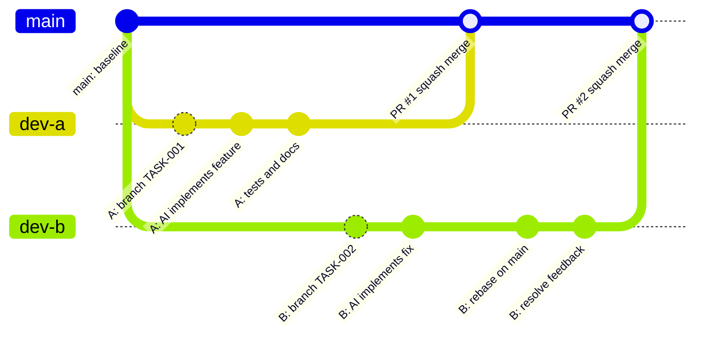

# AI-First Engineering Handbook

Version: 1.1 (May 2026)

Tämä dokumentti on projektin ensisijainen kehityskäsikirja ihmisille ja AI-agenteille.

Se määrittelee:

- AI-agenttien toimintatavat
- kehitysprosessin
- Pull Request -käytännöt
- review-prosessin
- dokumentaatiomallin
- arkkitehtuuripäätökset
- Definition of Done -säännöt

Projektin tarkempi nykytila kuvataan tiedostoissa `AGENTS.md` ja `ARCHITECTURE.md`.

---

# Philosophy

Projekti on AI-first.

Tavoitteena on:

- AI tuottaa suuren osan koodista
- ihmiset tekevät tuote-, arkkitehtuuri- ja tietoturvapäätökset
- arkkitehtuuri pysyy hallittuna
- muutokset ovat pieniä ja tarkastettavia
- dokumentaatio antaa agentille riittävän kontekstin ilman raskasta prosessia

Perussääntö:

```text
Idea -> AI Implementation Plan -> Developer Approval -> Task(s) -> AI Implementation -> AI Review -> Human Review -> PR -> Developer Merge -> Deploy
```

---

# Repository Structure

```text
repo/
|
├── AGENTS.md
├── ARCHITECTURE.md
├── AI-FIRST-ENGINEERING-HANDBOOK.md
├── README.md
|
├── docs/
|   ├── AI-DEVELOPMENT-WORKFLOW.md
|   ├── LOCAL-DEVELOPMENT.md
|   ├── domains/
|   |   ├── DOMAIN.md
|   |   ├── DOMAIN-TEMPLATE.md
|   |   └── <DOMAIN>.md
|   ├── concepts/
|   |   ├── CONCEPTS.md
|   |   ├── CONCEPT-TEMPLATE.md
|   |   └── <CONCEPT>.md
|   ├── data/
|   |   ├── DATA-MODEL.md
|   |   └── DATABASE.md
|   ├── diagrams/
|   |   ├── README.md
|   |   ├── *.puml
|   |   └── generated/
|   |       └── *.svg
|   └── decisions/
|       ├── ADR-001-*.md
|       ├── ADR-002-*.md
|       └── ...
|
├── tasks/
|   ├── TASK-TEMPLATE.md
|   ├── TASK-001-*.md
|   └── ...
|
├── db/
|   ├── migrations/
|   |   ├── README.md
|   |   └── 001_*.sql
|   └── init/
|       ├── README.md
|       └── 001_*.sql
|
├── frontend/
├── backend/
├── infra/
|
└── .github/
    ├── workflows/
    └── PULL_REQUEST_TEMPLATE.md
```

Kaikkia hakemistoja ei tarvitse täyttää ennen kuin projekti tarvitsee niitä.

---

# Source Of Truth

AI-agentin tulee lukea lähteet tässä järjestyksessä:

1. `AGENTS.md`
2. `ARCHITECTURE.md`
3. `docs/decisions/*.md`
4. `docs/domains/DOMAIN.md`
5. relevantit `docs/domains/<DOMAIN>.md` -tiedostot
6. `docs/concepts/CONCEPTS.md`
7. relevantit `docs/concepts/<CONCEPT>.md` -tiedostot
8. `docs/data/DATA-MODEL.md` ja `docs/data/DATABASE.md`, jos muutos koskee dataa tai skeemaa
9. `tasks/*.md`
10. `README.md`

Jos dokumentit ovat ristiriidassa:

- ADR voittaa vanhemman toteutuksen.
- `ARCHITECTURE.md` voittaa `README.md`:n.
- Domain-dokumentit määrittävät datan, APIen ja liiketoimintasääntöjen omistajuuden.
- Concept-dokumentit määrittävät keskeisten liiketoimintakäsitteiden merkityksen, invariantit ja lifecyclet.
- Data-dokumentit määrittävät loogisen ja fyysisen datamallin.
- Taskin scope voittaa yleisen toiveen, ellei task ole ristiriidassa arkkitehtuurin tai ADR:n kanssa.
- Jos vastausta ei löydy, kysy ihmiseltä päätös.

---

# Core Documents

## AGENTS.md

Projektin tärkein agenttikohtainen tiedosto.

Sisältää:

- projektin tarkoituksen
- nykyisen statuksen
- teknologiapinon
- agenttisäännöt
- lähteiden lukujärjestyksen
- mitä AI saa ja ei saa tehdä

Kaikkien agenttien tulee lukea tämä ensin.

## ARCHITECTURE.md

Kuvaa järjestelmän nykyisen arkkitehtuurin.

Sen tarkoitus on vastata:

```text
Mihin tämä ominaisuus kuuluu?
```

Tiedosto ei ole roadmap. Se kuvaa päätettyä tai toteutettua nykytilaa.

## ADR Documents

Kaikki merkittävät päätökset dokumentoidaan tiedostoon `docs/decisions/ADR-XXX-*.md`.

Kopioi uusi ADR pohjasta:

```text
docs/decisions/ADR-TEMPLATE.md
```

ADR tarvitaan, kun:

- valitaan uusi teknologia
- muutetaan arkkitehtuuria
- vaihdetaan tietokantastrategiaa
- muutetaan deployment-mallia
- lisätään merkittävä uusi integraatio tai infrakomponentti

Ensimmäiset suositellut ADR:t:

```text
ADR-001-tech-stack.md
ADR-002-database.md
ADR-003-authentication.md
ADR-004-deployment.md
```

## Domain Documents

Domain-dokumentit sijaitsevat hakemistossa `docs/domains/`.

`docs/domains/DOMAIN.md` antaa kokonaiskuvan domaineista ja niiden riippuvuuksista.

Jokaisella domainilla on oma tarkentava dokumentti:

```text
docs/domains/CUSTOMER.md
docs/domains/BILLING.md
docs/domains/DOCUMENT.md
docs/domains/AI.md
```

Domain-dokumentti kertoo:

- mitä domain omistaa
- mitä domain ei omista
- mitä tauluja domain saa muuttaa
- mitkä API-polut kuuluvat domainille
- mistä muista domaineista domain riippuu
- mitä agentin pitää välttää

AI-agentin tulee lukea relevantti domain-dokumentti ennen muutosta, joka koskee domainin dataa, APIeja tai liiketoimintasääntöjä.

## Concept Documents

Concept-dokumentit sijaitsevat hakemistossa `docs/concepts/`.

`docs/concepts/CONCEPTS.md` antaa kokonaiskuvan keskeisistä liiketoimintakäsitteistä.

Jokaisella merkittävällä käsitteellä on oma dokumentti:

```text
docs/concepts/CUSTOMER.md
docs/concepts/INVOICE.md
docs/concepts/DOCUMENT.md
docs/concepts/AI_EXTRACTION.md
```

Concept-dokumentti kertoo:

- mitä käsite tarkoittaa
- mitä käsite ei tarkoita
- mikä domain omistaa käsitteen
- mitkä kentät, suhteet ja invariantit ovat tärkeitä
- mikä lifecycle käsitteellä on
- mitä agentin pitää välttää

AI-agentin tulee lukea relevantti concept-dokumentti ennen muutosta, joka koskee käsitteen tulkintaa, kenttiä, suhteita, invariantteja tai lifecycleä.

## Data Documents

Datamallin dokumentit sijaitsevat hakemistossa `docs/data/`.

```text
docs/data/DATA-MODEL.md
docs/data/DATABASE.md
```

`DATA-MODEL.md` kuvaa loogisen datamallin:

- käsitteet
- entiteetit
- suhteet
- domain ownership
- invariantit

`DATABASE.md` kuvaa fyysisen tietokantamallin:

- taulut
- sarakkeet
- foreign keyt
- indeksit
- skeeman omistajuuden
- migraatiokäytännöt

Tietokantakaaviot piirretään PlantUML:llä:

```text
docs/diagrams/data-logical-model.puml
docs/diagrams/db-physical-schema.puml
docs/diagrams/generated/data-logical-model.svg
docs/diagrams/generated/db-physical-schema.svg
```

## Database Script Directories

Tietokantascriptit sijaitsevat hakemistossa `db/`.

```text
db/migrations/
db/init/
```

`db/migrations/` sisältää versionhallittavat skeemamuutokset.

Nimeämiskäytäntö:

```text
NNN_<verb>_<object>.sql
```

Esimerkkejä:

```text
001_create_customers.sql
002_create_contacts.sql
003_add_customer_soft_delete.sql
004_create_documents.sql
005_add_document_status.sql
```

Sallitut yleiset verbit:

- `create`
- `add`
- `alter`
- `rename`
- `drop`
- `backfill`

`db/init/` sisältää paikallisen tai kehitysympäristön alustusskriptejä.

Nimeämiskäytäntö:

```text
NNN_<action>_<purpose>.sql
```

Esimerkkejä:

```text
001_create_extensions.sql
002_seed_reference_data.sql
003_seed_development_users.sql
```

Init-skriptit eivät korvaa migraatioita. Jos skeema muuttuu, lisää aina migraatio `db/migrations/`-hakemistoon.

## Diagram Documents

Diagrammit sijaitsevat hakemistossa `docs/diagrams/`.

Säännöt:

- Arkkitehtuurikuvat piirretään C4 frameworkilla käyttäen PlantUML:ää.
- PlantUML-lähteet tallennetaan `docs/diagrams/*.puml`.
- Generoidut SVG-kuvat tallennetaan `docs/diagrams/generated/*.svg`.
- C4-kuvia käytetään system context-, container-, component- ja tarvittaessa code-tason kuvauksiin.
- Domain- ja concept-tason lifecycle-kuvauksiin saa käyttää PlantUML state-, sequence- tai activity-kaavioita.
- Mermaid `gitGraph` on sallittu Git-branchien kuvaamiseen.

Nimeämiskäytäntö on dokumentoitu tiedostossa `docs/diagrams/README.md`.

---

# Task Driven Development

Kaikki merkittävä työ alkaa ideasta, AI-agentin tekemästä toteutussuunnitelmasta ja kehittäjän hyväksynnästä.

Hyväksytystä suunnitelmasta luodaan yksi tai useampi task. Task on toteutuksen pysyvä scope-lähde.

`tasks/TASK-XXX-*.md` tarvitaan aina ennen toteutusta. Task kertoo:

- tavoitteen
- vaatimukset
- hyväksymiskriteerit
- ulos rajatut asiat
- toteutushuomiot
- testauksen
- dokumentaatiopäivitykset

Numerointisääntö:

- Käytä seuraavaa vapaata `TASK-XXX`-numeroa.
- Esimerkki: `tasks/TASK-042-user-profile.md`.
- Branch käyttää samaa numeroa: `feature/TASK-042-user-profile`.
- Jos yksi hyväksytty suunnitelma jaetaan useaan läheisesti liittyvään taskiin, käytä suffiksia: `TASK-042A-auth-api.md`, `TASK-042B-auth-ui.md`.

---

# Idea To Merge Workflow

## 1. Idea

Idea voi tulla ihmiseltä, käyttäjäpalautteesta, bugista tai teknisestä tarpeesta.

Tässä vaiheessa ei vielä tehdä koodia.

## 2. Ask AI For Implementation Plan

Kehittäjä pyytää AI-agentilta toteutussuunnitelman:

```text
Tee toteutussuunnitelma seuraavasta ideasta.

Idea:
[kuvaa tavoite, ongelma, rajaukset ja tunnetut taustatiedot]

Lue AGENTS.md, ARCHITECTURE.md ja relevantit ADR:t ennen suunnitelmaa.
Älä muuta tiedostoja. Ehdota tarvittavat taskit ja hyväksymiskriteerit.
```

AI-agentti ei tee tiedostomuutoksia suunnitteluvaiheessa.

## 3. Developer Approval

Kehittäjä tarkistaa suunnitelman ja hyväksyy sen tai pyytää muutoksia.

Tarkista erityisesti:

- tavoite ja rajaus
- taskien koko ja määrä
- arkkitehtuurivaikutukset
- tietoturva- ja tietokantavaikutukset
- hyväksymiskriteerit
- testaus

## 4. Create Task Spec

Task luodaan hyväksytystä suunnitelmasta tiedostoon:

```text
tasks/TASK-042-short-name.md
```

Taskissa määritellään:

- Goal
- Requirements
- Acceptance Criteria
- Out Of Scope
- Implementation Notes
- Testing
- Documentation

## 5. Scope Approval

Ihminen hyväksyy taskin scopin ennen toteutusta. Taskia ei toteuteta ennen hyväksyntää.

## 6. Create Branch

Kehittäjä luo oman branchin DEV-ympäristössä:

```bash
git checkout main
git pull origin main
git checkout -b feature/TASK-001-user-auth
```

Branch-nimi sisältää työn tyypin ja mielellään taskin numeron:

```text
feature/TASK-001-user-auth
fix/TASK-002-login-timeout
docs/TASK-003-agent-workflow
chore/TASK-004-ci-setup
refactor/TASK-005-auth-service
```

## 7. AI Implementation

AI-agentti:

- lukee `AGENTS.md`
- lukee `ARCHITECTURE.md`
- lukee relevantit ADR:t
- lukee taskin
- toteuttaa vain hyväksytyn scopin
- lisää tai päivittää testit
- päivittää dokumentaation tarvittaessa
- pitää muutokset pieninä

AI-agentti ei saa:

- muuttaa arkkitehtuuria ilman ADR:ää
- lisätä riippuvuuksia ilman hyväksyntää
- poistaa testejä
- commitoida salaisuuksia
- muuttaa tuotantoympäristöä
- mergata main-haaraan

## 8. Local Verification

Ennen pushia kehittäjä tai agentti ajaa projektin vaatimat tarkistukset.

Päätetyllä stackilla minimikomentoja ovat tyypillisesti:

```bash
cd frontend
pnpm format:check
pnpm lint
pnpm test
pnpm build

cd backend
uv run ruff check .
uv run pytest
uv run pyright
```

Kun typecheck-scripti on lisätty frontendiin, aja myös se ennen PR:ää.

## 9. Update Branch Before PR

Ennen PR:ää branch päivitetään mainin päälle:

```bash
git fetch origin
git rebase origin/main
```

Jos rebase ei ole tiimille tuttu, voidaan käyttää mergeä, mutta valitaan yksi tapa ja kirjataan se `CONTRIBUTING.md`:hen.

## 10. Push Branch

```bash
git push -u origin feature/TASK-001-user-auth
```

## 11. Open Pull Request

PR:ssä pitää näkyä:

- mitä tehtiin
- mihin taskiin muutos liittyy
- mitkä hyväksymiskriteerit täyttyvät
- miten testattiin
- mitkä riskit tai rajaukset jäivät

## 12. Continuous Integration

Jokaisessa PR:ssä suoritetaan, kun sovelluksen stack on valittu:

```text
Install
Format check
Lint
Test
Build
```

Merge estetään, jos CI epäonnistuu.

## 13. AI Review

Ensimmäinen review voidaan tehdä AI-agentilla.

AI-review tarkistaa:

- vastaako muutos taskia
- onko regressioriskejä
- puuttuuko testejä
- onko tietoturvaongelmia
- onko dokumentaatio päivittämättä

Jokainen AI-review-kierros tallennetaan versionhallittuna, redaktoituna JSON-
recordina `docs/ai-reviews/TASK-XXX/review-NNN.json`. Record säilyttää
reviewatun committed diffin SHA-viitteet, lopputuloksen, findingit ja myöhemmän
kierroksen dispositionit. Tarkka schema, redaktointisäännöt ja validointi ovat
`docs/AI-REVIEW-RECORDS.md`:ssä.

Review rajaa `docs/ai-reviews/**` pois omasta scopestaan, jotta metadatarecordin
commitointi ei aiheuta rekursiivista review'ta. Jos findingeja korjataan, tee
uusi review-kierros ja dispositionoi aiemmat findingit siinä; älä kirjoita
alkuperäistä recordia uudelleen. Aja ennen pushia:

```bash
python3 scripts/ai_review_records.py validate
```

`summarize`-komennolla tehty analyysi on neuvoa-antava. Se ei ole CI- tai
merge-gate eikä AI-agentti saa luoda tai hyväksyä follow-up-työtä ilman
kehittäjän päätöstä.

## 14. Human Review

Ihminen tarkistaa:

- Scope: vastaako taskia
- Architecture: noudattaako `ARCHITECTURE.md`:tä
- Security: onko ratkaisu turvallinen
- Database: ovatko migraatiot järkeviä
- Maintainability: onko toteutus ylläpidettävä

## 15. Merge

Kehittäjä mergaa hyväksytyn PR:n `main`-haaraan. AI-agentti voi auttaa yhteenvedossa, tarkistuksissa ja reviewssa, mutta agentti ei tee mergeä.

Käytetään:

```text
Squash and Merge
```

Squash-commit noudattaa Conventional Commits -muotoa:

```text
feat(auth): implement login flow
fix(api): validate document upload input
docs(workflow): document AI-first PR process
```

## 16. Deploy

Kun deployment on päätetty ADR:ssä, julkaisu seuraa hyväksyttyä runbookia.
Merge mainiin tai vihreä CI ei itsessään ole tuotantojulkaisun hyväksyntä.

Schattenin nykyinen malli:

```text
main -> GitHub Actions -> commit-specific images -> human deployment gate -> production
```

ADR-005:n mukaisesti Schattenilla ei ole staging-ympäristöä. Jokainen
tuotantojulkaisu vaatii `docs/DEPLOYMENT.md`:ssä määritellyn backup-, rollback-,
hyväksyntä- ja rajatun production smoke -portin. Tuotantojulkaisu on ihmisen
vastuulla.

## 17. Close Work

Työ suljetaan, kun:

- task merkitään valmiiksi
- dokumentaatio on ajan tasalla
- mahdollinen release/deploy on tarkistettu

---

# Developer Branch Workflow

Kaksi kehittäjää voi tehdä työtä rinnakkain omissa DEV-ympäristöissään:



Sama käytännössä:

```bash
git checkout main
git pull origin main
git checkout -b feature/TASK-001-user-auth

# toteutus AI-agentilla
# testit ja paikallinen tarkistus

git fetch origin
git rebase origin/main
git push -u origin feature/TASK-001-user-auth
```

---

# Pull Request Policy

Pakolliset ehdot:

- PR liittyy yhteen taskiin.
- CI on vihreä, kun CI on käytössä.
- Hyväksymiskriteerit täyttyvät.
- Testit on lisätty tai puuttuminen perustellaan.
- Dokumentaatio on päivitetty tarvittaessa.
- Vähintään yksi hyväksyntä ennen mergeä.

Suositus:

- alle 500 riviä reviewattavaa muutosta
- yksi looginen muutos per PR

---

# Review Checklist

```markdown
## Scope

- [ ] Vastaa taskia
- [ ] Ei sisällä tarpeetonta lisäscopea

## Architecture

- [ ] Noudattaa ARCHITECTURE.md:tä
- [ ] Ei muuta arkkitehtuuria ilman ADR:ää

## Security

- [ ] Input validoitu
- [ ] Authorization tarkistettu backendissä
- [ ] Ei salaisuuksia
- [ ] Ei sensitiivistä dataa lokeissa

## Database

- [ ] Skeemamuutokset migraatioina
- [ ] Ei manuaalisia tuotantomuutoksia

## Testing

- [ ] Testit mukana
- [ ] Kriittiset polut katettu
- [ ] Testit ajettu

## Documentation

- [ ] Dokumentaatio päivitetty tarvittaessa
- [ ] ADR lisätty tarvittaessa

## AI Review Record

- [ ] Jokaisesta AI-review-kierroksesta on validoitu record
      `docs/ai-reviews/TASK-XXX/review-NNN.json`
- [ ] Record ei sisällä promptia, raakaa model outputia, patchia, salaisuutta,
      tokenia, henkilötietoa tai query-parametreja sisältävää URL:ia
- [ ] Avoimet findingit ja accepted riskit on nostettu human review'hun
```

---

# Branch Policy

## Main

`main` on suojattu haara.

Säännöt:

- ei suoria pushauksia
- kaikki muutokset PR:n kautta
- CI:n pitää mennä läpi
- vähintään yksi approval
- stale approvalit mitätöidään uusien muutosten jälkeen

## Branch Naming

```text
feature/TASK-001-user-auth
fix/TASK-002-login-timeout
docs/TASK-003-workflow
chore/TASK-004-ci
refactor/TASK-005-auth-service
```

---

# Commit Policy

Käytetään Conventional Commits -mallia.

Esimerkkejä:

```text
feat(auth): add login endpoint
fix(auth): fix refresh token validation
docs(architecture): update deployment diagram
test(auth): add login tests
chore(ci): add pull request checks
```

Pidä commitit pieninä ja loogisina.

---

# CI/CD Policy

Kun sovelluksen stack on valittu, jokaisessa PR:ssä suoritetaan:

```text
Install
Format check
Lint
Test
Typecheck
Build
```

Suositeltu GitHub Actions -putki dokumentoidaan tiedostossa `.github/workflows/ci.yml`.

Jos projektissa ei vielä ole sovelluskoodia, CI saa olla kevyt dokumentaatiotarkistus. Varsinainen build/lint/test/typecheck otetaan käyttöön heti, kun frontend- ja backend-rungot on alustettu.

---

# Environment Variables

Älä koskaan commitoi:

```text
.env
.env.local
```

Repossa säilytetään vain:

```text
.env.example
```

Esimerkki:

```env
DATABASE_URL=
APP_URL=http://localhost:3000
ENTRA_ID_TENANT_ID=
ENTRA_ID_CLIENT_ID=
```

Salaisuudet tallennetaan ympäristökohtaisiin secret-varastoihin, ei repositoryyn.

---

# Database Policy

Kaikki skeemamuutokset tehdään migraatioina ja versionhallitaan.

Kielletty:

```sql
ALTER TABLE production ...
```

manuaalisesti tuotantoympäristössä.

ORM on SQLAlchemy. Migraatioiden generointi- ja ajokomennot dokumentoidaan `README.md`:ssä tai `docs/LOCAL-DEVELOPMENT.md`:ssä, kun migraatiotyökalu on valittu.

---

# Logging And Observability

Sovellus kirjoittaa tuotannossa lokit stdoutiin.

Tuotantokoodissa vältetään satunnaista `console.log`-debuggausta. Käytetään projektin loggeria, kun sellainen on valittu.

Lokeihin ei saa kirjoittaa:

- salasanoja
- API-avaimia
- access tokeneita
- henkilötietoja ilman perustetta
- koko request/response-bodya, jos se voi sisältää sensitiivistä dataa

Myöhemmin lisättävät observability-osat dokumentoidaan ADR:llä, jos ne vaikuttavat arkkitehtuuriin.

---

# Backup And Recovery

Kun tuotantotietokanta otetaan käyttöön:

- automaattiset backupit pitää olla päällä
- palautus pitää testata vähintään neljännesvuosittain
- backupien omistaja ja sijainti dokumentoidaan

Backupit eivät korvaa migraatioita eivätkä versionhallintaa.

---

# Security Policy

Pakollista:

- input validation
- authentication checks
- authorization checks backendissä
- parameterized SQL tai ORM:n turvalliset kyselyt
- HTTPS tuotannossa; dokumentoitu paikallinen kehitys voi käyttää HTTP:tä
- secrets ympäristömuuttujissa tai secret managerissa

Kielletty:

- hardcoded secrets
- API-avaimet repositoryssa
- testidatan käyttö tuotannossa
- tuotantodatan lataaminen lokaaliin kehitykseen ilman erillistä hyväksyntää

---

# Documentation Policy

Dokumentaatio päivitetään, jos:

- arkkitehtuuri muuttuu
- tietomalli muuttuu
- domain boundary tai domain ownership muuttuu
- conceptin merkitys, invariantit tai lifecycle muuttuu
- integraatio muuttuu
- deployment muuttuu
- arkkitehtuurikuva, domain-kuva tai workflow-kuva muuttuu
- tietokantakaavio tai migraatiomalli muuttuu
- uusi toimintamalli lisätään
- taskin toteutus muuttaa aiempaa oletusta

Projektin alussa riittävä minimi:

```text
AGENTS.md
ARCHITECTURE.md
AI-FIRST-ENGINEERING-HANDBOOK.md
docs/AI-DEVELOPMENT-WORKFLOW.md
docs/LOCAL-DEVELOPMENT.md
docs/domains/DOMAIN.md
docs/domains/DOMAIN-TEMPLATE.md
docs/concepts/CONCEPTS.md
docs/concepts/CONCEPT-TEMPLATE.md
docs/data/DATA-MODEL.md
docs/data/DATABASE.md
docs/diagrams/README.md
db/migrations/README.md
db/init/README.md
docs/decisions/ADR-001-tech-stack.md
tasks/TASK-TEMPLATE.md
```

---

# Junior Developer AI Workflow

Kun juniorikoodari käyttää AI-agenttia:

1. Kuvaa idea AI-agentille ja pyydä toteutussuunnitelma.
2. Tarkista ja hyväksy suunnitelma.
3. Luo tai lue hyväksytystä suunnitelmasta tehty `tasks/TASK-XXX-*.md`.
4. Luo branch mainista.
5. Anna agentille taskin polku ja pyydä toteuttamaan vain sen scope.
6. Pyydä agenttia ajamaan testit ja kertomaan tulokset.
7. Tarkista diff itse ennen pushia.
8. Avaa PR käyttäen templatea.
9. Pyydä AI-review PR:stä tai diffistä, tallenna validi redaktoitu record ja
   lisää sen polku PR:ään.
10. Korjaa löydökset, dokumentoi niiden dispositionit seuraavassa
    review-recordissa ja pyydä uusi review.
11. Pyydä human review.

Hyvä agenttiprompti:

```text
Lue AGENTS.md, ARCHITECTURE.md ja tasks/TASK-001-user-auth.md.
Toteuta vain taskissa määritelty scope.
Älä lisää uusia riippuvuuksia ilman hyväksyntää.
Lisää testit ja päivitä dokumentaatio tarvittaessa.
Lopuksi kerro mitä muutettiin ja mitkä tarkistukset ajoit.
```

Jos agentti ehdottaa arkkitehtuurimuutosta, uutta riippuvuutta tai tietokantastrategian muutosta, pysähdy ja pyydä ihmisen päätös.

---

# Definition Of Done

Työ on valmis kun:

- hyväksymiskriteerit täyttyvät
- testit läpäisevät
- CI on vihreä, kun CI on käytössä
- AI review tehty
- Human review tehty
- dokumentaatio päivitetty tarvittaessa
- PR mergeattu
- deploy tarkistettu, jos muutos julkaistaan

---

# Recommended GitHub Settings

Branch Protection:

- Require Pull Request
- Require Status Checks
- Require 1 Approval
- Dismiss Stale Approvals

Merge Strategy:

- Squash Merge Only

Disallow:

- Direct Push to Main

Recommended labels:

```text
bug
feature
enhancement
documentation
tech-debt
security
performance
good-first-task
```

---

# First Sprint Seed Tasks

Projektin käynnistykseen suositellut ensimmäiset taskit:

```text
TASK-001 Project bootstrap
TASK-002 Tech stack documentation alignment
TASK-003 Local development environment
TASK-004 CI baseline
TASK-005 Authentication implementation plan
TASK-006 Database migration tooling decision
TASK-007 Deployment implementation plan
TASK-008 Audit logging requirements
```

---

# Golden Rule

AI saa kirjoittaa koodin.

Ihmiset omistavat:

- tuotteen
- arkkitehtuurin
- tietoturvan
- lopulliset päätökset
- julkaisut
