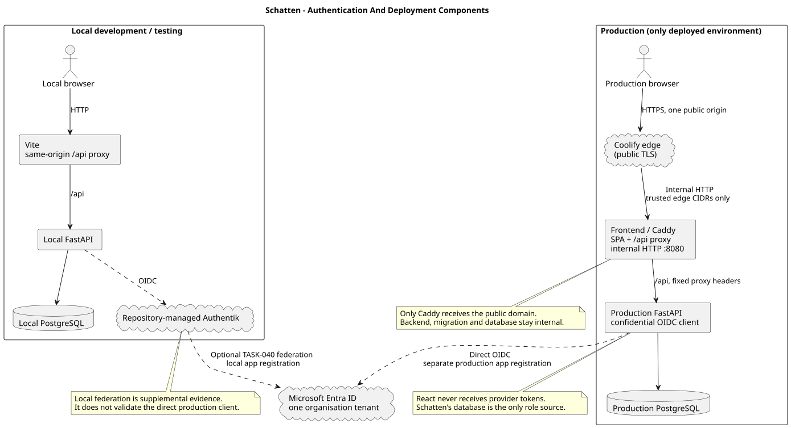
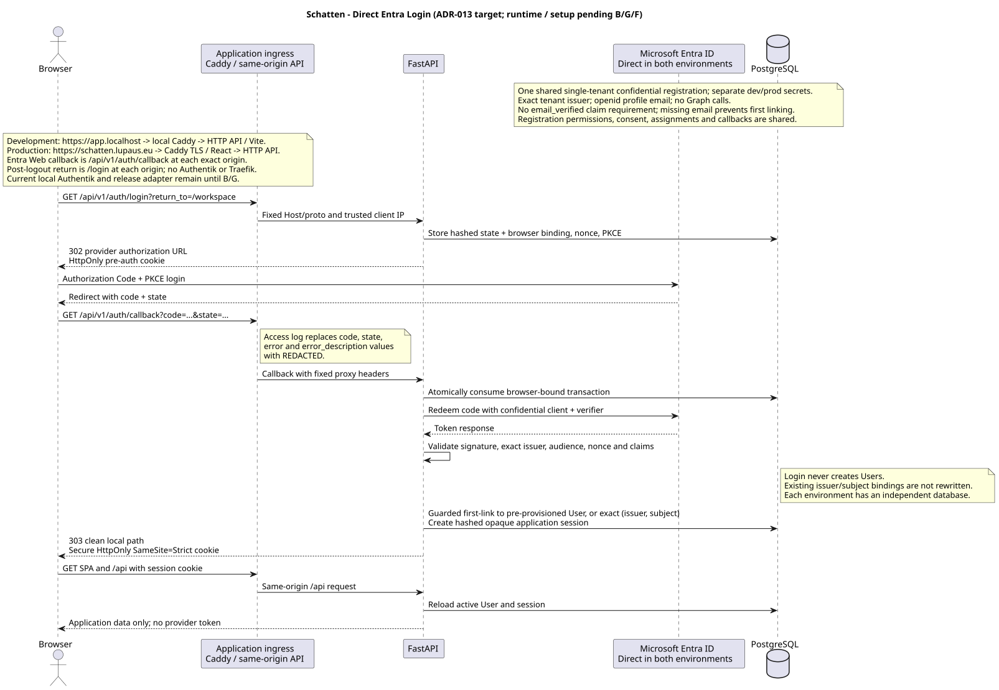

# Architecture

Tämä dokumentti kuvaa Schatten-projektin nykyisen arkkitehtuurin.

Tämän tiedoston tulee kuvata päätettyä tai toteutettua nykytilaa. Tulevaisuuden suunnitelmat, vaihtoehdot ja päätösten perustelut kirjataan ADR-dokumentteihin.

---

# Current Status

Status: MVP bootstrap with authentication and release ingress implemented

Teknologiapino on päätetty ADR-001:ssä.

Päätetty tekninen perusrakenne:

- frontend: React, TypeScript, Vite, pnpm, Vitest, ESLint hakemistossa `frontend/`
- backend: Python, FastAPI, Pydantic, uv, pytest, pyright, Ruff hakemistossa `backend/`
- database: PostgreSQL
- ORM: SQLAlchemy
- authentication: provider-neutral backend OIDC; repository-managed Authentik
  locally, optionally federated to Entra, and direct Microsoft Entra ID in
  production
- local runtime: frontend, backend, database and local-only Authentik in Docker
  contexts
- production-only deployment: Coolify Docker Compose with a Caddy same-origin
  frontend ingress
- release migrations: one-shot job using the same backend image as the API

Tarkemmat toteutusyksityiskohdat täsmentyvät taskien ja tarvittaessa uusien ADR:ien kautta.

---

# System Overview

Tuotteen nimi: Schatten

Kuvaus: TBD

Kun tuotesuunta täsmentyy, lisää tähän lyhyt kuvaus:

- mitä järjestelmä tekee
- ketkä ovat käyttäjiä
- mitkä ovat MVP:n keskeiset käyttötapaukset

---

# Implemented Runtime Shape

Production-rakenne:

```text
Browser --HTTPS--> Coolify edge --internal HTTP--> Frontend/Caddy :8080
                                                   | React SPA
                                                   +--/api--> FastAPI :8000
                                                               |--> PostgreSQL
                                                               +--> Entra ID
```

Only frontend/Caddy receives the public application domain. FastAPI and the
one-shot migration service remain internal. Local development replaces the
Coolify/Caddy edge with Vite's same-origin `/api` proxy and uses
repository-managed Authentik. TASK-040 may federate local Authentik to Entra,
but production connects FastAPI directly to Entra. There is no deployed
staging environment.

---

# Frontend

Status: React UI and production Caddy target implemented

Frontend sijaitsee hakemistossa:

```text
frontend/
```

Teknologiat:

- React
- TypeScript
- Vite
- pnpm
- Vitest
- ESLint

Frontend kutsuu backendin APIa saman originin `/api`-polulla. Tuotantoimage
rakentaa Vite SPA:n ja palvelee sen pinnatulla virallisella Caddy-imagella.
Caddy tarjoaa history fallbackin, proxyaa `/api`:n, hylkää väärän Hostin,
ylikirjoittaa luotetut proxy-headerit, redaktoi sensitiiviset query-arvot ja
asettaa CSP- sekä muut selainsecurity-headerit. Frontend ei tee suoria
tietokantakutsuja eikä sisällä luotettavaa authorization-logiikkaa.

## Frontend Principles

Frontend ei saa olla järjestelmän turvallisuusraja.

Frontend ei:

- tee suoria tietokantakutsuja
- sisällä ensisijaista authorization-logiikkaa
- ohita backendin validointia

Kaikki luotettava data ja oikeustarkistus kulkee backendin kautta.

---

# Backend

Status: FastAPI application and authentication boundary implemented

Backend sijaitsee hakemistossa:

```text
backend/
```

Teknologiat:

- Python
- FastAPI
- Pydantic
- uv
- pytest
- pyright
- Ruff
- SQLAlchemy

Backend tarjoaa API-rajapinnan frontendille ja vastaa luotettavasta validoinnista, autentikoinnista, authorizationista, liiketoimintalogiikasta ja tietokantaoperaatioista. API-skeemat ja validointi tehdään Pydanticilla FastAPI:n käytäntöjen mukaisesti.

OIDC-, session-, authentication- ja initial authorization -malli on toteutettu
ADR-004:n mukaisesti.

## Backend Principles

Backend on järjestelmän luotettava sovelluskerros.

Backend vastaa:

- liiketoimintalogiikasta
- input validationista
- autentikoinnista
- valtuutuksesta
- tietokantaoperaatioista
- integraatioiden eristämisestä

---

# Database

Status: decided in ADR-001

Tietokanta:

- PostgreSQL
- SQLAlchemy ORM
- repository-owned Python/Psycopg migration runner

Migraatiostrategia on päätetty ADR-002:ssa. Versionhallittavat SQL-migraatiot
muodostavat lineaarisen ketjun, jokaisella up-migraatiolla on down-vastine ja
runner seuraa sovellettuja migraatioita PostgreSQL:n `schema_migrations`-taulussa.
Migraatioita ei ajeta FastAPI-prosessin käynnistyksessä. ADR-003:n mukaisessa
deploymentissa erillinen one-shot release job ajaa kaikki puuttuvat migraatiot
ennen uuden backend-palvelun käynnistymistä.

## Database Principles

- Yksi ensisijainen totuuden lähde.
- Kaikki skeemamuutokset tehdään migraatioina.
- Migraatiot versionhallitaan.
- Jokaisella up-migraatiolla on down-migraatio.
- Migraatiot sijaitsevat `db/migrations/`-hakemistossa.
- Kehitysympäristön alustusskriptit sijaitsevat `db/init/`-hakemistossa.
- Tuotantotietokantaa ei muuteta käsin.

## Candidate Core Entities

Nämä ovat alustavia mahdollisia entiteettejä, eivät vielä lopullinen tietomalli:

```text
User
Organization
Membership
AuditEvent
```

Lopullinen tietomalli määritellään taskien ja ADR:ien kautta.

---

# Concept Model

Status: initial candidate model

Concept documentation is maintained in:

- `docs/concepts/CONCEPTS.md`
- `docs/concepts/<CONCEPT>.md`

Concept documents define:

- business meaning
- owning domain
- key fields
- invariants
- lifecycle
- relationships to other concepts

Architecture rule:

```text
If a concept changes meaning, lifecycle or ownership, update concept, domain, data and diagram documentation together.
```

---

# Authentication

Status: backend OIDC and application-session boundary implemented

FastAPI on confidential OIDC relying party. Sama provider-neutral flow käyttää
repository-managed Authentikia paikallisesti ja single-tenant Entraa suoraan
productionissa. TASK-040 voi liittää paikallisen Authentikin Entraan rajattua
provider-rehearsalia varten, mutta se ei validoi productionin suoraa
Schatten-to-Entra OIDC-clientia. Local federation ja production käyttävät saman
tenantin erillisiä confidential Web app registrationeita. React ei ole OIDC
client eikä providerin access-, refresh- tai ID-token koskaan siirry browserille.

ADR-004:n mukainen opaque sovellusistunto tallennetaan palvelinpuolelle vain
hashatulla tunnisteella. FastAPI validoi istunnon ja aktiivisen User-rivin
jokaisella autentikoidulla pyynnöllä. Istunnolla on 30 minuutin idle- ja
kahdeksan tunnin absoluuttinen enimmäisaika, ja admin voi revokoida käyttäjän
kaikki sovellusistunnot.

Ensimmäinen onnistunut linkitys vaatii aktiivisen pre-provisionoidun Userin ja
matching emailin; tämän jälkeen exact, case-sensitive `(issuer, subject)` on
pysyvä avain. Missing email, väärä tenant/issuer tai ristiriitainen linkitys
failaa suljetusti.

Salasanapolitiikkaa ei hallita sovelluksessa, ellei Entra ID -integraation ulkopuolelle lisätä erillistä kirjautumistapaa.

Tunnetut rajat: ei organisation membership authorizationia, back-channel
logoutia, immediate IdP revocationia, provider group mappingia, Graph-kutsuja,
refresh tokeneita tai SCIM-provisionointia. Kaikkien aktiivisten sisäisten
käyttäjien all-organisation access ja rajattu Entra email first-link ovat
hyväksyttyjä trust-model-valintoja, eivät toteutusaukkoja.

Authentication component- ja login sequence -kuvat:

- `docs/diagrams/component-authentication-topology.puml`
- `docs/diagrams/sequence-oidc-login.puml`





---

# Authorization

Status: initial internal-tool model implemented from ADR-004

Periaate:

- Health sekä tarvittavat auth login-, callback- ja session-transport-reitit
  ovat julkisia. Muut `/api/v1`-reitit vaativat aktiivisen istunnon.
- Users-hallinta ja käyttäjän istuntojen revokointi vaativat tietokannan
  `admin`-roolin.
- Sekä `admin` että `consultant` saavat käyttää kaikkia muita business-APIeja
  kaikkien organisaatioiden dataan.
- Kaikki autentikoidut `POST`, `PUT`, `PATCH` ja `DELETE` -pyynnöt vaativat
  istuntokohtaisen CSRF-headerin ja tarkan konfiguroidun Origin-arvon.
- Frontendin tarkistuksia käytetään vain käyttökokemukseen, ei turvallisuusmekanismina.

Kaikkien käyttäjien pääsy kaikkiin organisaatioihin on hyväksytty sisäisen
työkalun trust boundary, ei toteuttamatta jäänyt object-level authorization.
Mallia on arvioitava uudelleen ennen ulkopuolisten käyttäjien hyväksymistä tai
organisaatioeristyksen lisäämistä. Route `orgId`, sähköposti, Entra tenant,
provider-ryhmä tai token claim ei muodosta membershipiä tai käyttöoikeutta.

---

# API Design

Status: initial direction

Backend toteutetaan FastAPI:lla. API-tyyli on alustavasti HTTP/JSON.

Endpointien nimeämiskäytäntö, request/response-malli, virheformaatti ja versionointikäytäntö täsmennetään ensimmäisissä API-taskeissa.

Alustava virheformaattisuositus:

```json
{
  "error": {
    "code": "VALIDATION_ERROR",
    "message": "Email is required"
  }
}
```

---

# Users

Status: implemented frontend and backend CRUD baseline

Users Domain owns application-wide user records, application roles and the
user soft-delete lifecycle. The domain boundary and rules are documented in
`docs/domains/USERS.md`.

Backend implementation resides in:

```text
backend/app/api/v1/users/
```

The versioned HTTP/JSON API provides active-user list, get, create, patch and
soft-delete operations under:

```text
/api/v1/users
```

Frontend Users UI resides in:

```text
frontend/src/features/users/
```

`UsersTab.tsx` lists active users and supports create, edit and confirmed
soft-delete operations through `frontend/src/api/users.ts`. The workspace tab
is available at `/schatten/:orgId/users` without a scenario or organisation
state selection. The route is part of the current workspace navigation shell,
but users remain application-wide: `orgId` is not included in Users Domain API
requests and does not establish organisation membership.

Users administration is protected by the backend `admin` role. Active Users
obtain their own profile from `/api/v1/auth/session`; the workspace route
remains only navigation context and does not establish organisation membership.

# Customers

Status: implemented backend API and frontend management UI

Customer Domain owns application-wide customer profiles, contacts, addresses
and their soft-delete lifecycles. The domain boundary and rules are documented
in `docs/domains/CUSTOMER.md`.

Backend implementation resides in:

```text
backend/app/api/v1/customers/
```

The versioned HTTP/JSON API provides customer lookup, search, filtering,
replacement and soft deletion under `/api/v1/customers`. Contact and address
management uses nested customer routes. The service layer enforces active or
archived parent visibility, child ownership, normalization and transactional
customer-to-child soft-delete propagation. Normal reads exclude soft-deleted
records.

Customer records remain application-wide. Both authenticated roles may manage
them under the accepted internal-tool trust model; no organisation-specific
ownership is inferred from the workspace route.

The frontend management view resides in
`frontend/src/features/customers/CustomersTab.tsx` and is routed through the
existing organisation workspace at `/schatten/:orgId/customers`. The workspace
organisation id is navigation context only: Customer Domain API paths and
payloads do not contain an organisation, scenario or organisation-state id.

---

# Org Twin Structure

Status: implemented baseline

Org Twin Structure kuvaa skenaarion ajallisen graph-rakenteen. Domain omistaa
metamodelit, node- ja edge-tyypit, allowed connection -säännöt sekä graph-nodet
ja -edget. Tarkempi domain-omistajuus on dokumentissa
`docs/domains/ORG_TWIN_STRUCTURE.md`.

Backend toteutus sijaitsee hakemistossa:

```text
backend/app/api/v1/org_twin_structure/
```

Keskeiset backend-komponentit:

- `router.py` julkaisee versionoidut HTTP/JSON endpointit.
- `schemas.py` määrittää Pydantic request- ja response-mallit.
- `org_twin_structure_service.py` sisältää graph-, node-, edge- ja
  type catalog -operaatioiden palvelulogiikan.
- `models.py` sisältää SQLAlchemy-mallit domainin omistamille tauluille.

Endpointit ovat organisaatio-, skenaario- ja organisaatiotila-kontekstissa:

```text
GET    /api/v1/organisations/{organisation_key}/scenarios/{scenario_key}/graph/history
GET    /api/v1/organisations/{organisation_key}/scenarios/{scenario_key}/graph/types
GET    /api/v1/organisations/{organisation_key}/scenarios/{scenario_key}/org-states/{org_state_key}/graph
GET    /api/v1/organisations/{organisation_key}/scenarios/{scenario_key}/org-states/{org_state_key}/graph/types
POST   /api/v1/organisations/{organisation_key}/scenarios/{scenario_key}/org-states/{org_state_key}/graph/nodes
PATCH  /api/v1/organisations/{organisation_key}/scenarios/{scenario_key}/org-states/{org_state_key}/graph/nodes/{node_key}
DELETE /api/v1/organisations/{organisation_key}/scenarios/{scenario_key}/org-states/{org_state_key}/graph/nodes/{node_key}
POST   /api/v1/organisations/{organisation_key}/scenarios/{scenario_key}/org-states/{org_state_key}/graph/edges
PATCH  /api/v1/organisations/{organisation_key}/scenarios/{scenario_key}/org-states/{org_state_key}/graph/edges/{edge_key}
DELETE /api/v1/organisations/{organisation_key}/scenarios/{scenario_key}/org-states/{org_state_key}/graph/edges/{edge_key}
PATCH  /api/v1/organisations/{organisation_key}/scenarios/{scenario_key}/org-states/{org_state_key}/graph/positions
```

`graph_nodes`- ja `graph_edges`-rivit kuuluvat skenaarioon. `create_date` ja
nullable `delete_date` määrittävät loogisen elinkaaren. Organisaatiotilan graph
on projektio, jossa elementti näkyy, kun sen elinkaari sisältää tilan
`target_date`-päivän. `deleted_time` on erillinen persistence-soft-delete,
jota käytetään esimerkiksi skenaarion poistossa, cleanupissa sekä silloin, kun
Structure-poisto tehdään elementin `create_date`-päivänä. Tällöin myös poistetun
noden yhteydessä olevat edget persistence-soft-deletoidaan.

Frontend Structure UI sijaitsee hakemistossa:

```text
frontend/src/features/structure/
```

Keskeiset frontend-komponentit:

- `StructureTab.tsx` lataa graphin ja type catalogin valitulle skenaariolle ja
  organisaatiotilalle, hallitsee paikallisen UI-tilan ja kutsuu API-clientia.
- `GraphViewer.tsx` renderoi graphin Cytoscape.js:lla ja käsittelee valinnan,
  zoomauksen, panoroinnin, keskittämisen ja node-dragit.
- `GraphEditorToolbar.tsx`, `NodeForm.tsx` ja `EdgeForm.tsx` tarjoavat create-,
  show/edit- ja AI Assistant -moodien kontrollit ja editointilomakkeet.
- `NodeList.tsx` näyttää nodet tyyppiryhmittäin, tyyppikohtaiset laskurit,
  näkyvyysfiltterit ja nodeen fokusoinnin.
- `frontend/src/api/orgTwinStructure.ts` sisältää typed fetch -wrapperit
  graphin, type catalogin, nodejen, edgejen ja position bulk updatejen käyttöön.

Workspace-liitos:

- `frontend/src/workspace/workspaceTabs.ts` määrittää `"graph"`-tabin labeliksi
  `Structure`.
- Structure-tab säilyttää skenaario- ja organisaatiotilavalinnan vaatimuksen.

Authorization:

- Structure API requires an active backend session and the common unsafe-request
  guard for mutations.
- Both application roles intentionally access Structure resources in every
  organisation; organisation membership authorization is not implemented or
  claimed.

## Summary Timeline

Frontend Summary UI sijaitsee hakemistossa:

```text
frontend/src/features/summary/
```

`SummaryTab.tsx` lataa valitulle skenaariolle graph-historian, graph-tyypit,
tapahtumat ja aikasarjat rinnakkain. Se renderöi ne yhteiselle päiväakselille
ilman organisaatiotilan valintavaatimusta. Valittu organisaatiotila laajentaa
aikajanaa target date -päivällään, jos tila on saatavilla.

`summaryTimeline.ts` sisältää testattavat päivämäärä-, järjestys-, suodatus-,
zoom- ja chart scale -funktiot. Summary tarjoaa category- ja node type
-suodatuksen, Rows-valikon rivikohtaisen näkyvyyden, rivien caret-ohjauksen
laajennukseen ja kokoon taittamiseen, synkronoidun scrollauksen sekä yhteisen
timeseries-rivikorkeuden. Näkyviin palautettava rivi laajennetaan samalla.
Timeline header näyttää riittävän leveässä näkymässä vuoden ja lyhennetyn
kuukauden, tiivistyy ensin lyhyisiin kuukausilabeleihin ja vaihtaa
year-only-näkymään, kun nekään eivät mahdu; tällöin rivit näyttävät kuukausirajat
pystyviivoina. Filters- ja Rows-valikot ovat toisensa poissulkevia.

---

# Domain Architecture

Status: initial candidate model

Domain boundaries are documented in:

- `docs/domains/DOMAIN.md`
- `docs/domains/<DOMAIN>.md`

Domain documents define:

- data ownership
- table ownership
- API ownership
- domain rules
- cross-domain dependencies
- AI-agent implementation guidance

Architecture rule:

```text
One domain may reference another domain's data, but it may not modify another domain's owned tables directly.
```

If implementation requires changing domain ownership or introducing a new domain, update `docs/domains/DOMAIN.md` and create or update the relevant domain document. Add an ADR if the change affects system architecture.

---

# Architecture Diagrams

Architecture diagrams are documented in:

- `docs/diagrams/README.md`
- `docs/diagrams/*.puml`
- `docs/diagrams/generated/*.svg`

Rules:

- Use C4 framework with PlantUML for architecture diagrams.
- Use C4 Level 1 for system context.
- Use C4 Level 2 for containers.
- Use C4 Level 3 for components.
- Use C4 Level 4 only when the code-level view is genuinely useful.
- Use PlantUML state, sequence or activity diagrams for domain lifecycle and concept-level behavior when C4 is not the right fit.
- Use PlantUML ER-style or class-style diagrams for logical and physical data model views when useful.

Generated SVG files are documentation artifacts. Do not edit them manually; update the `.puml` source and regenerate the SVG.

---

# Integrations

Status: TBD

Ulkoiset integraatiot kirjataan tähän, kun niitä lisätään.

## Integration Principles

Integraatiot eristetään adaptereihin tai palveluihin.

Ei:

```text
Business Logic -> direct third-party API call
```

Kyllä:

```text
Business Logic -> Domain Service -> Integration Adapter
```

Uusi merkittävä integraatio vaatii taskin ja tarvittaessa ADR:n.

---

# Background Jobs

Status: TBD

Jos projektiin lisätään ajastettuja töitä, queue tai worker-prosesseja, päätös dokumentoidaan ADR:llä.

Mahdollisia käyttötapauksia:

- sähköpostit
- raportit
- integraatiosynkronoinnit
- audit trail -prosessointi

---

# Observability

Status: TBD

## Logging

Tuotannossa sovellus kirjoittaa lokit stdoutiin.

Lokeihin ei saa kirjoittaa:

- salasanoja
- API-avaimia
- access tokeneita
- tarpeetonta henkilötietoa

## Metrics

Mahdollisia mittareita myöhemmin:

- request count
- error count
- response time
- job failure count

---

# Security

Pakolliset periaatteet:

- HTTPS tuotannossa
- input validation
- backend authorization checks
- secrets ympäristömuuttujissa tai secret managerissa
- parameterized SQL tai ORM:n turvalliset kyselyt

Kielletty:

- hardcoded secrets
- SQL injection -riskit
- sensitiivisen datan lokitus
- tuotantodatan käyttö testidatana ilman hyväksyntää

---

# Deployment

Status: production-only baseline decided in ADR-003 and ADR-005

Production-deployment tehdään Coolifyssa Docker Compose -topologialla. ADR-005
poistaa staging-ympäristön aktiivisesta mallista muuttamatta ADR-003:n
production-topologiaa tai ADR-001:n historiallista teknologiapäätöstä.

Tavoitemalli:

```text
GitHub
   |
   v
GitHub Actions
   |
   +--> backend image (commit-specific)
   |       |
   |       +--> one-shot migration job --> PostgreSQL
   |       |
   |       +--> backend after migration success
   |                    |
   +--> frontend/Caddy image (same commit)
                           |
                           +--> starts after backend health
                                      |
                                      +--> Coolify production public domain
```

Backendin production-image sisältää sovelluksen, migraatio-runnerin ja
versionhallittavat SQL-migraatiot. Migration- ja backend-palvelut käyttävät samaa
immutable imageä ja `DATABASE_URL`:ia. Migration-palvelun epäonnistuminen estää
uuden backendin käynnistymisen. Erillinen saman commitin frontend-image sisältää
rakennetun React SPA:n ja Caddyn. Frontend käynnistyy vasta backendin health
checkin jälkeen ja on ainoa julkisen production-domainin vastaanottava palvelu.

Coolify Docker Compose ei takaa rolling- tai zero-downtime deploymentia.
Application rollback ei aja down-migraatiota automaattisesti, ja onnistuneesti
ajetut forward-migraatiot jätetään paikalleen. Skeemamuutokset julkaistaan
expand/contract-mallilla.

## Infrastructure Principles

Sovellusta ei sidota tarpeettomasti yhteen alustaan.

Ympäristöjen tulee käyttää:

- versionhallittua konfiguraatiota
- ympäristömuuttujia
- toistettavaa build- ja deployment-prosessia
- dokumentoitua tietokantayhteyttä
- provider-neutralia API- ja migration-komentoa
- provider-kohtaisten manifestikenttien eristämistä sovelluskoodista

---

# ADR References

Päätökset:

```text
ADR-001 Tech Stack: accepted
ADR-002 Database Migration Tool: accepted
ADR-003 Coolify Deployment And Release Migrations: accepted
ADR-004 Authentication, Identity And Session Architecture: accepted
ADR-005 Production-Only Deployment Environments: accepted
```

---

# Architecture Constraints

AI-agenttien tulee noudattaa seuraavia sääntöjä.

## Do

- Noudata olemassa olevia kerroksia.
- Lisää uudet ominaisuudet oikeaan paikkaan.
- Käytä olemassa olevia palveluita ja abstrahointeja.
- Ehdota ADR:ää, jos toteutus vaatii arkkitehtuuripäätöksen.

## Don't

- Älä lisää uusia kerroksia ilman ADR:ää.
- Älä ohita backend-logiikkaa frontendistä.
- Älä lisää uusia infrastruktuurikomponentteja ilman päätöstä.
- Älä lukitse teknologiaa taskin sivutuotteena.

---

# Future Changes

Kun arkkitehtuuri muuttuu:

1. Lisää tai päivitä ADR tarvittaessa.
2. Päivitä tämä tiedosto.
3. Päivitä `AGENTS.md`, jos agenttien sääntöihin tai lukujärjestykseen tulee muutos.

Tämän dokumentin tulee aina kuvata järjestelmän nykytila.
