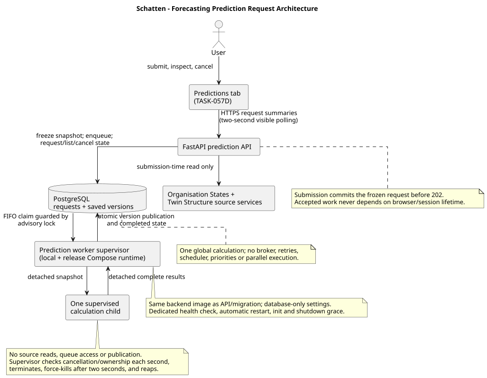

# Architecture

Tämä dokumentti kuvaa Schatten-projektin nykyisen arkkitehtuurin.

Tämän tiedoston tulee kuvata päätettyä tai toteutettua nykytilaa. Tulevaisuuden suunnitelmat, vaihtoehdot ja päätösten perustelut kirjataan ADR-dokumentteihin.

---

# Current Status

Status: MVP bootstrap with authentication and release ingress implemented

[ADR-013](docs/decisions/ADR-013-shared-entra-local-https-deployment.md) accepts
direct Entra in both environments, distinct HTTPS origins, a shared registration,
and Docker deployment on UpCloud Ubuntu 26.04 LTS with direct Caddy TLS and
private Docker PostgreSQL 18. Daily encrypted on-server backups with 7-day
retention and backup/restore evidence are required. The reference-data seed,
empty-users-table administrator bootstrap, production runtime, build/release and
backup/scheduler tooling, integrated QA and the operator runbook
(`docs/PRODUCTION-RUNBOOK.md`) are implemented; production activation/rollout
remain pending F.

Teknologiapino on päätetty ADR-001:ssä.

Päätetty tekninen perusrakenne:

- frontend: React, TypeScript, Vite, pnpm, Vitest, ESLint hakemistossa `frontend/`
- backend: Python, FastAPI, Pydantic, uv, pytest, pyright, Ruff hakemistossa `backend/`
- database: PostgreSQL
- ORM: SQLAlchemy
- authentication target: provider-neutral backend OIDC connecting directly to
  Microsoft Entra ID in development and production
- local target: Caddy HTTPS, Vite, FastAPI, one prediction worker and PostgreSQL
- production target: Docker Engine/Compose on UpCloud Ubuntu 26.04 LTS, Caddy
  public TLS and private PostgreSQL 18 with persistent storage (runtime
  implemented by G; rollout pending F)
- release migrations: one-shot job using the same backend image as the API and
  prediction worker
- derived metrics: Organisation States owns equations and materialized values;
  Forecasting derives prediction result points from normal-metric results
  according to ADR-010
- prediction intervals: Forecasting owns one immutable version-level nominal
  coverage selection and model-specific bounds for directly fitted MLForecast
  and SARIMA results according to ADR-011; baselines, live Reality and
  formula-derived results remain point-only
- background prediction requests: ADR-012's PostgreSQL-backed single-worker
  architecture, detached snapshot preparation, durable request persistence,
  request APIs, supervised worker calculation, atomic publication, current-tab
  UI and supported-runtime wiring are implemented

Tarkemmat toteutusyksityiskohdat täsmentyvät taskien ja tarvittaessa uusien ADR:ien kautta.

---

# System Overview

Tuotteen nimi: Schatten

Kuvaus: TBD

Kun tuotesuunta täsmentyy, lisää tähän lyhyt kuvaus:

- mitä järjestelmä tekee
- ketkä ovat käyttäjiä
- mitkä ovat MVP:n keskeiset käyttötapaukset

---

# Accepted Runtime Shape And Implementation Status

```text
Development: Browser --HTTPS--> local Caddy --> Vite / FastAPI --> Entra
Production:  Browser --HTTPS--> Caddy (React) --/api--> FastAPI --> Entra
                                                       |--> PostgreSQL 18
Prediction worker ------------------------------------> PostgreSQL 18
Migration job ----------------------------------------> PostgreSQL 18
```

The production host is UpCloud Ubuntu 26.04 LTS. Caddy owns public TLS and
persistent certificates. API, worker, migration job and database remain private;
PostgreSQL runs in Docker with persistent storage initially. Migration success
gates API/worker startup; backend health gates frontend readiness. Both API
and worker use the same immutable backend image; worker config is database-only.

The checked-in development runtime is loopback `https://app.localhost` through
local Caddy to Vite/FastAPI and direct Entra. Caddy fixes the API Host/proxy
headers and Vite HMR uses WSS on the same HTTPS origin. Existing Authentik
volumes and identity rows are preserved but Authentik is not an active runtime
dependency. The Coolify/Traefik adapter was removed by G. No
Authentik, Traefik, forward-auth or `auth.lupaus.eu` is needed in the target.
There is no staging environment.

---

# Frontend

Status: React UI and production Caddy target implemented

Frontend sijaitsee hakemistossa:

```text
frontend/
```

Teknologiat:

- React
- TypeScript
- Vite
- pnpm
- Vitest
- ESLint

Frontend kutsuu backendin APIa saman originin `/api`-polulla. Tuotantoimage
rakentaa Vite SPA:n ja palvelee sen pinnatulla virallisella Caddy-imagella.
Caddy tarjoaa history fallbackin, proxyaa `/api`:n, hylkää väärän Hostin,
ylikirjoittaa luotetut proxy-headerit, redaktoi sensitiiviset query-arvot ja
asettaa CSP- sekä muut selainsecurity-headerit. Frontend ei tee suoria
tietokantakutsuja eikä sisällä luotettavaa authorization-logiikkaa.

## Frontend Principles

Frontend ei saa olla järjestelmän turvallisuusraja.

Frontend ei:

- tee suoria tietokantakutsuja
- sisällä ensisijaista authorization-logiikkaa
- ohita backendin validointia

Kaikki luotettava data ja oikeustarkistus kulkee backendin kautta.

---

# Backend

Status: FastAPI application and authentication boundary implemented

Backend sijaitsee hakemistossa:

```text
backend/
```

Teknologiat:

- Python
- FastAPI
- Pydantic
- uv
- pytest
- pyright
- Ruff
- SQLAlchemy

Backend tarjoaa API-rajapinnan frontendille ja vastaa luotettavasta validoinnista, autentikoinnista, authorizationista, liiketoimintalogiikasta ja tietokantaoperaatioista. API-skeemat ja validointi tehdään Pydanticilla FastAPI:n käytäntöjen mukaisesti.

OIDC-, session-, authentication- ja initial authorization -malli on toteutettu
ADR-004:n mukaisesti.

## Backend Principles

Backend on järjestelmän luotettava sovelluskerros.

Backend vastaa:

- liiketoimintalogiikasta
- input validationista
- autentikoinnista
- valtuutuksesta
- tietokantaoperaatioista
- integraatioiden eristämisestä

---

# Database

Status: decided in ADR-001

Tietokanta:

- PostgreSQL
- SQLAlchemy ORM
- repository-owned Python/Psycopg migration runner

Migraatiostrategia on päätetty ADR-002:ssa. Versionhallittavat SQL-migraatiot
muodostavat lineaarisen ketjun, jokaisella up-migraatiolla on down-vastine ja
runner seuraa sovellettuja migraatioita PostgreSQL:n `schema_migrations`-taulussa.
Migraatioita ei ajeta FastAPI-prosessin käynnistyksessä. ADR-003:n mukaisessa
deploymentissa erillinen one-shot release job ajaa kaikki puuttuvat migraatiot
ennen uuden backend-palvelun käynnistymistä.

## Database Principles

- Yksi ensisijainen totuuden lähde.
- Kaikki skeemamuutokset tehdään migraatioina.
- Migraatiot versionhallitaan.
- Jokaisella up-migraatiolla on down-migraatio.
- Migraatiot sijaitsevat `db/migrations/`-hakemistossa.
- Kehitysympäristön alustusskriptit sijaitsevat `db/init/`-hakemistossa.
- Tuotantotietokantaa ei muuteta käsin.

## Candidate Core Entities

Nämä ovat alustavia mahdollisia entiteettejä, eivät vielä lopullinen tietomalli:

```text
User
Organization
Membership
AuditEvent
```

Lopullinen tietomalli määritellään taskien ja ADR:ien kautta.

---

# Concept Model

Status: initial candidate model

Concept documentation is maintained in:

- `docs/concepts/CONCEPTS.md`
- `docs/concepts/<CONCEPT>.md`

Concept documents define:

- business meaning
- owning domain
- key fields
- invariants
- lifecycle
- relationships to other concepts

Architecture rule:

```text
If a concept changes meaning, lifecycle or ownership, update concept, domain, data and diagram documentation together.
```

---

# Authentication

Status: backend OIDC and application-session boundary implemented

FastAPI is a confidential OIDC relying party. ADR-013 selects direct
single-tenant Entra in both environments using the existing shared registration
and distinct secrets. React is not an OIDC client and receives no provider tokens.
Local Caddy/direct-Entra is implemented. Historical federation QA does not
verify the direct-Entra development or production ingress.

| Purpose | Development | Production |
| --- | --- | --- |
| Public origin | `https://app.localhost` | `https://schatten.lupaus.eu` |
| Entra Web callback | `https://app.localhost/api/v1/auth/callback` | `https://schatten.lupaus.eu/api/v1/auth/callback` |
| Post-logout return | `https://app.localhost/login` | `https://schatten.lupaus.eu/login` |

Use exact tenant-specific issuer, `openid profile email`, no Graph calls and
no `email_verified` requirement. Registration identity, consent, permissions,
assignments and callbacks are shared despite separate credentials. Application
databases and cookies remain independent. Remove obsolete Authentik callbacks
and its Graph permission from target configuration; actual tenant cleanup
requires authorized setup and checks for other consumers under F.

Retain guarded linking to a pre-provisioned active User and permanent
`(issuer, subject)` ownership. Never rewrite old Authentik identities, create
Users during login or copy sessions between environments. B provides explicit
local-only designated-admin provisioning for already-seeded databases; D's
production bootstrap remains restricted to a completely empty users table.

ADR-004:n mukainen opaque sovellusistunto tallennetaan palvelinpuolelle vain
hashatulla tunnisteella. FastAPI validoi istunnon ja aktiivisen User-rivin
jokaisella autentikoidulla pyynnöllä. Istunnolla on 30 minuutin idle- ja
kahdeksan tunnin absoluuttinen enimmäisaika, ja admin voi revokoida käyttäjän
kaikki sovellusistunnot.

Ensimmäinen onnistunut linkitys vaatii aktiivisen pre-provisionoidun Userin ja
matching emailin; tämän jälkeen exact, case-sensitive `(issuer, subject)` on
pysyvä avain. Missing email, väärä tenant/issuer tai ristiriitainen linkitys
failaa suljetusti.

Salasanapolitiikkaa ei hallita sovelluksessa, ellei Entra ID -integraation ulkopuolelle lisätä erillistä kirjautumistapaa.

Tunnetut rajat: ei organisation membership authorizationia, back-channel
logoutia, immediate IdP revocationia, provider group mappingia, Graph-kutsuja,
refresh tokeneita tai SCIM-provisionointia. Kaikkien aktiivisten sisäisten
käyttäjien all-organisation access ja rajattu Entra email first-link ovat
hyväksyttyjä trust-model-valintoja, eivät toteutusaukkoja.

Authentication component- ja login sequence -kuvat:

- `docs/diagrams/component-authentication-topology.puml`
- `docs/diagrams/sequence-oidc-login.puml`


---

# Authorization

Status: initial internal-tool model implemented from ADR-004

Periaate:

- Health sekä tarvittavat auth login-, callback- ja session-transport-reitit
  ovat julkisia. Muut `/api/v1`-reitit vaativat aktiivisen istunnon.
- Users-hallinta ja käyttäjän istuntojen revokointi vaativat tietokannan
  `admin`-roolin.
- Sekä `admin` että `consultant` saavat käyttää kaikkia muita business-APIeja
  kaikkien organisaatioiden dataan.
- Kaikki autentikoidut `POST`, `PUT`, `PATCH` ja `DELETE` -pyynnöt vaativat
  istuntokohtaisen CSRF-headerin ja tarkan konfiguroidun Origin-arvon.
- Frontendin tarkistuksia käytetään vain käyttökokemukseen, ei turvallisuusmekanismina.

Kaikkien käyttäjien pääsy kaikkiin organisaatioihin on hyväksytty sisäisen
työkalun trust boundary, ei toteuttamatta jäänyt object-level authorization.
Mallia on arvioitava uudelleen ennen ulkopuolisten käyttäjien hyväksymistä tai
organisaatioeristyksen lisäämistä. Route `orgId`, sähköposti, Entra tenant,
provider-ryhmä tai token claim ei muodosta membershipiä tai käyttöoikeutta.

---

# API Design

Status: initial direction

Backend toteutetaan FastAPI:lla. API-tyyli on alustavasti HTTP/JSON.

Endpointien nimeämiskäytäntö, request/response-malli, virheformaatti ja versionointikäytäntö täsmennetään ensimmäisissä API-taskeissa.

Alustava virheformaattisuositus:

```json
{
  "error": {
    "code": "VALIDATION_ERROR",
    "message": "Email is required"
  }
}
```

---

# Users

Status: implemented frontend and backend CRUD baseline

Users Domain owns application-wide user records, application roles and the
user soft-delete lifecycle. The domain boundary and rules are documented in
`docs/domains/USERS.md`.

Backend implementation resides in:

```text
backend/app/api/v1/users/
```

The versioned HTTP/JSON API provides active-user list, get, create, patch and
soft-delete operations under:

```text
/api/v1/users
```

Frontend Users UI resides in:

```text
frontend/src/features/users/
```

`UsersTab.tsx` lists active users and supports create, edit and confirmed
soft-delete operations through `frontend/src/api/users.ts`. The workspace tab
is available at `/schatten/:orgId/users` without a scenario or organisation
state selection. The route is part of the current workspace navigation shell,
but users remain application-wide: `orgId` is not included in Users Domain API
requests and does not establish organisation membership.

Users administration is protected by the backend `admin` role. Active Users
obtain their own profile from `/api/v1/auth/session`; the workspace route
remains only navigation context and does not establish organisation membership.

# Customers

Status: implemented backend API and frontend management UI

Customer Domain owns application-wide customer profiles, contacts, addresses
and their soft-delete lifecycles. The domain boundary and rules are documented
in `docs/domains/CUSTOMER.md`.

Backend implementation resides in:

```text
backend/app/api/v1/customers/
```

The versioned HTTP/JSON API provides customer lookup, search, filtering,
replacement and soft deletion under `/api/v1/customers`. Contact and address
management uses nested customer routes. The service layer enforces active or
archived parent visibility, child ownership, normalization and transactional
customer-to-child soft-delete propagation. Normal reads exclude soft-deleted
records.

Customer records remain application-wide. Both authenticated roles may manage
them under the accepted internal-tool trust model; no organisation-specific
ownership is inferred from the workspace route.

The frontend management view resides in
`frontend/src/features/customers/CustomersTab.tsx` and is routed through the
existing organisation workspace at `/schatten/:orgId/customers`. The workspace
organisation id is navigation context only: Customer Domain API paths and
payloads do not contain an organisation, scenario or organisation-state id.

---

# Org Twin Structure

Status: implemented baseline

Org Twin Structure kuvaa skenaarion ajallisen graph-rakenteen. Domain omistaa
metamodelit, node- ja edge-tyypit, allowed connection -säännöt sekä graph-nodet
ja -edget. Tarkempi domain-omistajuus on dokumentissa
`docs/domains/ORG_TWIN_STRUCTURE.md`.

Backend toteutus sijaitsee hakemistossa:

```text
backend/app/api/v1/org_twin_structure/
```

Keskeiset backend-komponentit:

- `router.py` julkaisee versionoidut HTTP/JSON endpointit.
- `schemas.py` määrittää Pydantic request- ja response-mallit.
- `org_twin_structure_service.py` sisältää graph-, node-, edge- ja
  type catalog -operaatioiden palvelulogiikan.
- `models.py` sisältää SQLAlchemy-mallit domainin omistamille tauluille.

Endpointit ovat organisaatio-, skenaario- ja organisaatiotila-kontekstissa:

```text
GET    /api/v1/organisations/{organisation_key}/scenarios/{scenario_key}/graph/history
GET    /api/v1/organisations/{organisation_key}/scenarios/{scenario_key}/graph/types
GET    /api/v1/organisations/{organisation_key}/scenarios/{scenario_key}/org-states/{org_state_key}/graph
GET    /api/v1/organisations/{organisation_key}/scenarios/{scenario_key}/org-states/{org_state_key}/graph/types
POST   /api/v1/organisations/{organisation_key}/scenarios/{scenario_key}/org-states/{org_state_key}/graph/nodes
PATCH  /api/v1/organisations/{organisation_key}/scenarios/{scenario_key}/org-states/{org_state_key}/graph/nodes/{node_key}
DELETE /api/v1/organisations/{organisation_key}/scenarios/{scenario_key}/org-states/{org_state_key}/graph/nodes/{node_key}
POST   /api/v1/organisations/{organisation_key}/scenarios/{scenario_key}/org-states/{org_state_key}/graph/edges
PATCH  /api/v1/organisations/{organisation_key}/scenarios/{scenario_key}/org-states/{org_state_key}/graph/edges/{edge_key}
DELETE /api/v1/organisations/{organisation_key}/scenarios/{scenario_key}/org-states/{org_state_key}/graph/edges/{edge_key}
PATCH  /api/v1/organisations/{organisation_key}/scenarios/{scenario_key}/org-states/{org_state_key}/graph/positions
```

`graph_nodes`- ja `graph_edges`-rivit kuuluvat skenaarioon. `create_date` ja
nullable `delete_date` määrittävät loogisen elinkaaren. Organisaatiotilan graph
on projektio, jossa elementti näkyy, kun sen elinkaari sisältää tilan
`target_date`-päivän. `deleted_time` on erillinen persistence-soft-delete,
jota käytetään esimerkiksi skenaarion poistossa, cleanupissa sekä silloin, kun
Structure-poisto tehdään elementin `create_date`-päivänä. Tällöin myös poistetun
noden yhteydessä olevat edget persistence-soft-deletoidaan.

Frontend Structure UI sijaitsee hakemistossa:

```text
frontend/src/features/structure/
```

Keskeiset frontend-komponentit:

- `StructureTab.tsx` lataa graphin ja type catalogin valitulle skenaariolle ja
  organisaatiotilalle, hallitsee paikallisen UI-tilan ja kutsuu API-clientia.
- `GraphViewer.tsx` renderoi graphin Cytoscape.js:lla ja käsittelee valinnan,
  zoomauksen, panoroinnin, keskittämisen ja node-dragit.
- `GraphEditorToolbar.tsx`, `NodeForm.tsx` ja `EdgeForm.tsx` tarjoavat create-,
  show/edit- ja AI Assistant -moodien kontrollit ja editointilomakkeet.
- `NodeList.tsx` näyttää nodet tyyppiryhmittäin, tyyppikohtaiset laskurit,
  näkyvyysfiltterit ja nodeen fokusoinnin.
- `frontend/src/api/orgTwinStructure.ts` sisältää typed fetch -wrapperit
  graphin, type catalogin, nodejen, edgejen ja position bulk updatejen käyttöön.

Workspace-liitos:

- `frontend/src/workspace/workspaceTabs.ts` määrittää `"graph"`-tabin labeliksi
  `Structure`.
- Structure-tab säilyttää skenaario- ja organisaatiotilavalinnan vaatimuksen.

Authorization:

- Structure API requires an active backend session and the common unsafe-request
  guard for mutations.
- Both application roles intentionally access Structure resources in every
  organisation; organisation membership authorization is not implemented or
  claimed.

## Summary Timeline

Frontend Summary UI sijaitsee hakemistossa:

```text
frontend/src/features/summary/
```

`SummaryTab.tsx` lataa valitulle skenaariolle graph-historian, graph-tyypit,
tapahtumat ja aikasarjat rinnakkain. Se renderöi ne yhteiselle päiväakselille
ilman organisaatiotilan valintavaatimusta. Valittu organisaatiotila laajentaa
aikajanaa target date -päivällään, jos tila on saatavilla.

`summaryTimeline.ts` sisältää testattavat päivämäärä-, järjestys-, suodatus-,
zoom- ja chart scale -funktiot. Summary tarjoaa category- ja node type
-suodatuksen, Rows-valikon rivikohtaisen näkyvyyden, rivien caret-ohjauksen
laajennukseen ja kokoon taittamiseen, synkronoidun scrollauksen sekä yhteisen
timeseries-rivikorkeuden. Näkyviin palautettava rivi laajennetaan samalla.
Timeline header näyttää riittävän leveässä näkymässä vuoden ja lyhennetyn
kuukauden, tiivistyy ensin lyhyisiin kuukausilabeleihin ja vaihtaa
year-only-näkymään, kun nekään eivät mahdu; tällöin rivit näyttävät kuukausirajat
pystyviivoina. Filters- ja Rows-valikot ovat toisensa poissulkevia.

---

# Domain Architecture

Status: initial candidate model

Domain boundaries are documented in:

- `docs/domains/DOMAIN.md`
- `docs/domains/<DOMAIN>.md`

Domain documents define:

- data ownership
- table ownership
- API ownership
- domain rules
- cross-domain dependencies
- AI-agent implementation guidance

Architecture rule:

```text
One domain may reference another domain's data, but it may not modify another domain's owned tables directly.
```

If implementation requires changing domain ownership or introducing a new domain, update `docs/domains/DOMAIN.md` and create or update the relevant domain document. Add an ADR if the change affects system architecture.

---

# Architecture Diagrams

Architecture diagrams are documented in:

- `docs/diagrams/README.md`
- `docs/diagrams/*.puml`
- `docs/diagrams/generated/*.svg`

Rules:

- Use C4 framework with PlantUML for architecture diagrams.
- Use C4 Level 1 for system context.
- Use C4 Level 2 for containers.
- Use C4 Level 3 for components.
- Use C4 Level 4 only when the code-level view is genuinely useful.
- Use PlantUML state, sequence or activity diagrams for domain lifecycle and concept-level behavior when C4 is not the right fit.
- Use PlantUML ER-style or class-style diagrams for logical and physical data model views when useful.

Generated SVG files are documentation artifacts. Do not edit them manually; update the `.puml` source and regenerate the SVG.

---

# Integrations

Status: TBD

Ulkoiset integraatiot kirjataan tähän, kun niitä lisätään.

## Integration Principles

Integraatiot eristetään adaptereihin tai palveluihin.

Ei:

```text
Business Logic -> direct third-party API call
```

Kyllä:

```text
Business Logic -> Domain Service -> Integration Adapter
```

Uusi merkittävä integraatio vaatii taskin ja tarvittaessa ADR:n.

---

# Background Jobs

Status: Forecasting worker and supported-runtime wiring implemented

Forecasting uses the ADR-012 durable PostgreSQL request queue. The standalone
backend worker holds one session-level advisory lock, recovers abandoned active
requests, claims queued work globally in submission order and runs each detached
calculation in an isolated child process. The supervisor checks cancellation
and ownership every second, reaps stopped children, and atomically publishes a
complete immutable version with its completed request transition. It never
retries work or runs inside FastAPI.

TASK-057D owns the request UI. TASK-057E runs the worker in local and release
Compose as a distinct internal service with a dedicated database-lock health
check, automatic restart, Docker init process, and a ten-second shutdown grace.
No generic background-job platform, broker, scheduler, retries or parallel
processing is accepted.



---

# Observability

Status: TBD

## Logging

Tuotannossa sovellus kirjoittaa lokit stdoutiin.

Lokeihin ei saa kirjoittaa:

- salasanoja
- API-avaimia
- access tokeneita
- tarpeetonta henkilötietoa

## Metrics

Mahdollisia mittareita myöhemmin:

- request count
- error count
- response time
- job failure count

---

# Security

Pakolliset periaatteet:

- HTTPS tuotannossa
- input validation
- backend authorization checks
- secrets ympäristömuuttujissa tai secret managerissa
- parameterized SQL tai ORM:n turvalliset kyselyt

Kielletty:

- hardcoded secrets
- SQL injection -riskit
- sensitiivisen datan lokitus
- tuotantodatan käyttö testidatana ilman hyväksyntää

---

# Deployment

Status: ADR-013 amendment accepted; production runtime and tooling implemented
by TASK-059G (`docker-compose.production.yml`, `deploy/`); integrated runbook and
disposable QA by TASK-059E (`docs/PRODUCTION-RUNBOOK.md`); source delivery
without Git on the server amended by TASK-059H; manifest, receiver and Git-free
build (H1), upload gate and "Deploy to production" workflow (H2), and server
`deploy/Makefile`, `service` command and runbook (H3) implemented; operator
SSH from any address with key-only root (J) amended and implemented; rollout
pending F

Use Docker Engine/Compose on an **UpCloud Ubuntu 26.04 LTS** server. Caddy
serves built React and terminates public TLS directly at
`https://schatten.lupaus.eu`; it proxies `/api` to private FastAPI. Certificate
storage persists across replacements. PostgreSQL 18 initially runs privately
in Docker with persistent storage. Only Caddy exposes public application ports.
SSH port 22 is reachable from anywhere for GitHub-hosted runners and
operators on changing networks. `AllowUsers` admits only `deploy`, key-only
root (the product owner's direct login) and an upload-only account, and SSH
accepts public keys only (no password or keyboard-interactive login).
FastAPI trusts only actual Caddy peers and no upstream edge.

Source reaches the host through a manually started "Deploy to production"
GitHub Action restricted to `main`: it exports the exact commit, writes a source
manifest (commit, ref, `SOURCE_DATE_EPOCH`, run ID, per-file mode and SHA-256)
and copies both with a pinned SCP action to a dedicated upload-only account.
**Git is not used on the server.** A root-owned receiver verifies the upload
against the manifest digest the operator copies from the run summary and
copies only listed files into a read-only verified source folder, from which
operators build and deploy with `make -C <verified folder>/deploy <target>`
(thin wrappers over `deploy/bin`). Integrity
therefore rests on GitHub and the operator-entered digest rather than a
host-side commit check; ADR-013 records this weaker, accepted guarantee.

A dedicated Ofelia container schedules daily backups and weekly Docker cleanup;
it does not run application predictions. ADR-013 records its technology choice
and mandatory hardening: pinned images, no scheduler network/ports, fixed read-only
job configuration, confined local Docker socket and minimal runner mounts/secrets.
Socket access is host-administrator-equivalent even when mounted `:ro`; verify
the effective runner restrictions before activation. G implements the scheduler,
runners and effective-settings verification; E verified them on disposable
daemons and F verifies and activates them on the host.

Initial builds run on UpCloud from the verified delivered source of an approved
`main` commit and produce frozen, immutable matching frontend/backend images.
The Action builds and deploys nothing. API, migration and the single
prediction worker use the backend artifact; deployment does not rebuild.
Migration success gates API/worker, and backend health gates frontend readiness.
If builds fail or resource contention is unacceptable, consider GitHub Actions /
GHCR builds with the same artifact contract in separately reviewed work.

First initialization is **migrations -> approved non-user reference seed ->
empty-users-table administrator bootstrap**, then limited smoke. C's explicit,
database-only reference seed and D's administrator bootstrap are implemented and
run only through explicit operator commands. Never run the complete development seed in production or run
seed/bootstrap automatically on application startup.

**Initial backups are required:** daily encrypted on-server PostgreSQL backups
in `/opt/postgres-backups` with 7-day retention, completed backup identifiers and
successful isolated
restore-rehearsal evidence as release gates. Volumes survive container replacement
but are not backups. G implements tooling, E validates procedures and F activates
and verifies production backups under operational approval. Missing evidence
blocks release. This replaces the earlier no-initial-backup decision; the later
destination amendment selects on-server storage initially. Host or disk loss can
also destroy these backups; off-server protection is deferred and not a release gate.

A future UpCloud Managed PostgreSQL migration remains separately planned,
covering data transfer, connection/TLS/session advisory locks, cutover/rollback
and continuity of backup encryption, retention and restore verification.

Releases need explicit manual approval and narrow direct-Entra production smoke.
Compose does not promise zero downtime. Retain matched stable artifacts for
coordinated application rollback only if compatible with migrated schema;
use expand/contract changes. No automatic down migrations, volume deletion,
database reset or restoration. Application rollback cannot recover lost data;
first rollout has no previous stable release. Stop/escalate when rollback is
unavailable. E integrates B/C/D/G in the runbook; F performs separately
authorized setup/rollout.

## Infrastructure Principles

Sovellusta ei sidota tarpeettomasti yhteen alustaan.

Ympäristöjen tulee käyttää:

- versionhallittua konfiguraatiota
- ympäristömuuttujia
- toistettavaa build- ja deployment-prosessia
- dokumentoitua tietokantayhteyttä
- provider-neutralia API- ja migration-komentoa
- provider-kohtaisten manifestikenttien eristämistä sovelluskoodista

---

# ADR References

Päätökset:

```text
ADR-001 Tech Stack: accepted
ADR-002 Database Migration Tool: accepted
ADR-003 Coolify Deployment And Release Migrations: deployment superseded by ADR-013; release contract retained
ADR-004 Authentication, Identity And Session Architecture: accepted
ADR-005 Production-Only Deployment Environments: accepted
ADR-006 Local Authentik TLS And Optional Entra Federation: target superseded by ADR-013
ADR-013 Shared Entra Registration And Local HTTPS Deployment: accepted; source delivery H1-H3 implemented, rollout pending
```

---

# Architecture Constraints

AI-agenttien tulee noudattaa seuraavia sääntöjä.

## Do

- Noudata olemassa olevia kerroksia.
- Lisää uudet ominaisuudet oikeaan paikkaan.
- Käytä olemassa olevia palveluita ja abstrahointeja.
- Ehdota ADR:ää, jos toteutus vaatii arkkitehtuuripäätöksen.

## Don't

- Älä lisää uusia kerroksia ilman ADR:ää.
- Älä ohita backend-logiikkaa frontendistä.
- Älä lisää uusia infrastruktuurikomponentteja ilman päätöstä.
- Älä lukitse teknologiaa taskin sivutuotteena.

---

# Future Changes

Kun arkkitehtuuri muuttuu:

1. Lisää tai päivitä ADR tarvittaessa.
2. Päivitä tämä tiedosto.
3. Päivitä `AGENTS.md`, jos agenttien sääntöihin tai lukujärjestykseen tulee muutos.

Tämän dokumentin tulee aina kuvata järjestelmän nykytila.
