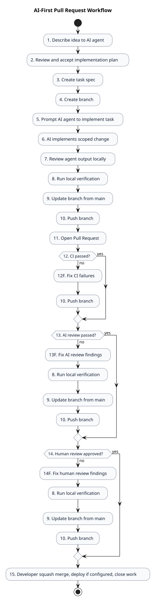

# AI Development Workflow

Tämä dokumentti kuvaa käytännön työnkulun, kun kehittäjä käyttää AI-agenttia suunnittelussa ja toteutuksessa.

Laajemmat säännöt ovat tiedostossa `AI-FIRST-ENGINEERING-HANDBOOK.md`.

---

# Workflow Diagram

Kaavion numerot vastaavat tämän dokumentin vaiheotsikoita. PlantUML-lähde on tiedostossa `docs/diagrams/ai-first-pr-workflow.puml`.



---

# Step By Step

## 1. Describe Idea To AI Agent

Työ alkaa ideasta, bugihavainnosta, käyttäjäpalautteesta tai teknisestä tarpeesta.

Kehittäjä pyytää AI-agentilta toteutussuunnitelman ennen taskien kirjoittamista:

```text
Tee toteutussuunnitelma seuraavasta ideasta.

Idea:
[kuvaa tavoite, ongelma, rajaukset ja tunnetut taustatiedot]

Lue AGENTS.md, ARCHITECTURE.md ja relevantit ADR:t ennen suunnitelmaa.
Älä muuta tiedostoja. Ehdota tarvittavat taskit ja hyväksymiskriteerit.
```

Tässä vaiheessa AI-agentti ei vielä tee koodimuutoksia.

## 2. Review And Accept Implementation Plan

Kehittäjä tarkistaa AI-agentin suunnitelmasta:

- ratkaiseeko suunnitelma oikean ongelman
- onko scope sopiva ja pieni
- tarvitaanko yksi vai useampi task
- vaatiiko työ ADR:n ennen toteutusta
- ovatko hyväksymiskriteerit ja testaus selkeät

Jos suunnitelma ei ole valmis, kehittäjä pyytää agenttia tarkentamaan sitä. Taskit luodaan vasta, kun kehittäjä hyväksyy suunnitelman.

## 3. Create Task Spec

Hyväksytystä suunnitelmasta luodaan yksi tai useampi task-tiedosto:

```text
tasks/TASK-042-short-name.md
```

Käytä seuraavaa vapaata `TASK-XXX`-numeroa. Jos yksi hyväksytty suunnitelma jaetaan useaan läheisesti liittyvään taskiin, käytä suffiksia:

```text
tasks/TASK-042A-auth-api.md
tasks/TASK-042B-auth-ui.md
tasks/TASK-042C-auth-tests.md
```

Taskin pitää kertoa agentille:

- mitä tehdään
- mitä ei tehdä
- millä kriteereillä työ hyväksytään
- miten työ testataan
- mitä dokumentaatiota pitää päivittää

Task on toteutuksen pysyvä scope-lähde.

## 4. Create Branch

```bash
git checkout main
git pull origin main
git checkout -b feature/TASK-042-short-name
```

Käytä branch-prefixejä:

```text
feature/
fix/
docs/
chore/
refactor/
```

Prefixien käyttö:

- `feature/` kun lisäät uuden käyttäjälle tai järjestelmälle näkyvän toiminnon
- `fix/` kun korjaat bugin tai virheellisen toiminnan
- `docs/` kun muutos koskee vain dokumentaatiota
- `chore/` kun teet ylläpitotyötä, joka ei muuta sovelluksen toimintaa
- `refactor/` kun muutat koodin rakennetta ilman tarkoituksellista toiminnallista muutosta

## 5. Prompt AI Agent To Implement Task

Hyvä prompti taskin pohjalta:

```text
Lue AGENTS.md, ARCHITECTURE.md, relevantit ADR:t, relevantit domain-dokumentit ja tasks/TASK-042-short-name.md.
Toteuta vain taskissa määritelty scope.
Älä lisää uusia riippuvuuksia ilman hyväksyntää.
Lisää testit ja päivitä dokumentaatio tarvittaessa.
Lopuksi kerro mitä muutettiin ja mitkä tarkistukset ajoit.
```

Jos työ koskee tietokantaa, lisää:

```text
Kaikki skeemamuutokset pitää tehdä migraatioina. Älä muuta tuotantotietokantaa.
```

Jos työ koskee arkkitehtuuria, lisää:

```text
Jos toteutus vaatii arkkitehtuurimuutoksen, pysähdy ja ehdota ADR:ää ennen koodausta.
```

## 6. AI Implements Scoped Change

AI-agentti:

- lukee sovitut lähdedokumentit
- toteuttaa vain taskin scopessa olevan muutoksen
- lisää tai päivittää testit, kun muutos koskee sovelluskoodia
- päivittää dokumentaation tarvittaessa
- ei lisää riippuvuuksia ilman hyväksyntää
- ei muuta arkkitehtuuria ilman ADR:ää
- ei mergaa main-haaraan

## 7. Review Agent Output Locally

Kehittäjä tarkistaa diffistä:

- toteuttaako muutos taskin
- lisäsikö agentti turhaa scopea
- lisäsikö agentti riippuvuuksia
- poistuiko testejä
- jäikö dokumentaatio päivittämättä
- syntyikö tietoturva- tai tietomallimuutoksia, joita ei ollut hyväksytty

## 8. Run Local Verification

Aja taskiin relevantit tarkistukset.

Backendin oletustarkistukset:

```bash
cd backend
uv run ruff check .
uv run pytest
uv run pyright
```

Frontendin oletustarkistukset:

```bash
cd frontend
pnpm lint
pnpm test
pnpm build
```

Kun typecheck-scripti on lisätty frontendiin, aja myös se ennen PR:ää.

## 9. Update Branch From Main

Ennen PR:ää:

```bash
git fetch origin
git rebase origin/main
```

Ratkaise konfliktit ja aja vaiheen 8 tarkistukset uudelleen.

## 10. Push Branch

```bash
git push -u origin feature/TASK-042-short-name
```

## 11. Open Pull Request

Käytä `.github/PULL_REQUEST_TEMPLATE.md` -templatea.

PR:ssä pitää näkyä:

- summary
- task
- acceptance criteria
- testing
- risks

## 12. CI

CI ajaa projektin määritellyt tarkistukset.

Minimiputki, kun sovelluskoodi on olemassa:

```text
Install
Lint
Tests
Typecheck
Build
```

Jos CI epäonnistuu, korjaa virheet, pushaa muutokset ja odota uusi CI-tulos ennen reviewn jatkamista.

## 13. AI Review

Pyydä AI-agenttia reviewaamaan diff tai PR.

AI-reviewn pitää etsiä:

- bugeja
- regressioita
- tietoturvaongelmia
- puuttuvia testejä
- dokumentaatiopuutteita
- taskin ulkopuolista scopea

Jos AI-review löytää korjattavaa, tee korjaukset ja palaa vaiheeseen 8.

## 14. Human Review

Ihminen tarkistaa lopullisesti:

- scope
- arkkitehtuuri
- turvallisuus
- tietokantamuutokset
- ylläpidettävyys

Jos human review pyytää muutoksia, tee korjaukset ja palaa vaiheeseen 8.

## 15. Squash Merge, Deploy, Close Work

Kehittäjä mergaa hyväksytyn PR:n `main`-haaraan. AI-agentti voi auttaa yhteenvedossa, tarkistuksissa ja reviewssa, mutta agentti ei tee mergeä.

Käytä:

```text
Squash and Merge
```

Squash-commit:

```text
feat(scope): short description
fix(scope): short description
docs(scope): short description
```

Kun deployment on konfiguroitu, production-julkaisu seuraa ADR-005:n
ihmisomisteista porttia. Production-topologia on dokumentoitu ADR-003:ssa ja
`docs/DEPLOYMENT.md`:ssä. Mainiin mergeä ei pidä tulkita itsessään
julkaisuhyväksynnäksi.

Lopuksi:

- task merkitään valmiiksi
- dokumentaatio jää ajan tasalle
- mahdollinen production-deploy, rajattu Entra-smoke ja rollback-evidence
  tarkistetaan erikseen hyväksytyn runbookin mukaan

---

# Parallel Developer Flow


Periaate:

- jokainen kehittäjä tekee oman branchin mainista
- jokainen työ linkitetään taskiin
- branch päivitetään mainista ennen PR:ää
- mainiin päätyy vain ihmisen reviewaama ja kehittäjän squash-mergaama muutos

---

# When To Stop And Ask

Pysähdy ja pyydä ihmisen päätös, jos AI-agentti:

- ehdottaa uutta riippuvuutta
- muuttaa arkkitehtuuria
- muuttaa tietokantastrategiaa
- tarvitsee salaisuuksia tai tuotantopääsyä
- haluaa poistaa testejä
- toteuttaa taskin ulkopuolista scopea
