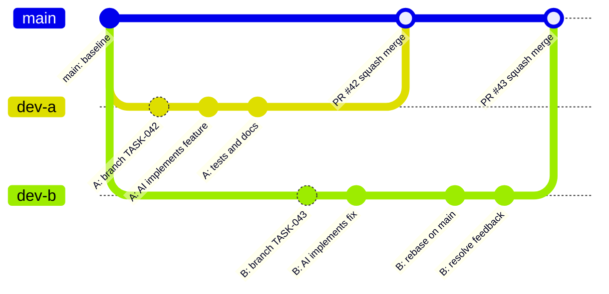

# AI Development Workflow

Tämä dokumentti kuvaa käytännön työnkulun, kun kehittäjä käyttää AI-agenttia toteutuksessa.

Laajemmat säännöt ovat tiedostossa `AI-FIRST-ENGINEERING-HANDBOOK.md`.

---

# Workflow Diagram

Kaavion numerot vastaavat tämän dokumentin vaiheotsikoita. PlantUML-lähde on tiedostossa `docs/diagrams/ai-first-pr-workflow.puml`.


---

# Step By Step

## 1. Select Or Create GitHub Issue

Luo GitHub Issue ennen työn aloittamista.

Issue toimii työnhallinnan lähteenä:

- mitä tehdään
- miksi tehdään
- kuka tekee
- mikä on työn status
- mihin PR linkittyy

Issue riittää toteutusspeksiksi vain, jos muutos on pieni ja yksiselitteinen.

Tärkeää: agentti ei automaattisesti tiedä GitHub Issuen sisältöä. Jos taskia ei tehdä, issuen sisältö pitää antaa agentille erikseen vaiheessa 3A.

## 2. Decide Whether Task Spec Is Needed

Luo task-tiedosto, jos muutos:

- koskee useampaa osaa sovelluksesta
- muuttaa tietomallia
- lisää integraation
- vaatii useita hyväksymiskriteerejä
- vaikuttaa arkkitehtuuriin
- annetaan AI-agentille itsenäisesti toteutettavaksi

Jos muutos on pieni ja issue sisältää riittävät hyväksymiskriteerit, voit käyttää pelkkää issuea ja jatkaa vaiheeseen 3A.

Jos task tarvitaan, jatka vaiheeseen 3B.

## 3A. Give Issue Context To Agent

Jos työ tehdään pelkän GitHub Issuen perusteella, käytä yhtä näistä tavoista.

### Option A: Paste Issue Content

Kopioi issue agentin promptiin:

```text
Toteuta GitHub Issue #42.

Title:
[Feature] User profile page

Body:
Goal:
...

Acceptance criteria:
- [ ] ...
- [ ] ...

Lue AGENTS.md ja ARCHITECTURE.md ennen toteutusta.
Toteuta vain tämän issuen scope.
```

Tämä on suositeltu tapa, jos agentilla ei ole GitHub-integraatiota.

### Option B: Let Agent Read Issue With Tooling

Jos ympäristössä on GitHub CLI tai GitHub-connector, prompti voi olla:

```text
Lue GitHub Issue #42 tästä reposta ja toteuta se.
Jos et pysty lukemaan issuea, pysähdy ja pyydä minua liittämään sen sisältö.
```

Tyypillinen komento:

```bash
gh issue view 42 --comments
```

Agentti saa jatkaa vasta, kun se on oikeasti saanut issuen sisällön.

## 3B. Create Task Spec

Kopioi `tasks/TASK-TEMPLATE.md` uuteen tiedostoon:

```text
tasks/TASK-042-short-name.md
```

Käytä task-numerona ensisijaisesti GitHub Issuen numeroa.

Esimerkki:

```text
GitHub Issue #42
tasks/TASK-042-user-profile.md
branch feature/TASK-042-user-profile
PR: Closes #42
```

Jos yhdestä issuesta syntyy useita taskeja:

```text
tasks/TASK-042A-auth-api.md
tasks/TASK-042B-auth-ui.md
tasks/TASK-042C-auth-tests.md
```

Taskin pitää kertoa agentille:

- mitä tehdään
- mitä ei tehdä
- millä kriteereillä työ hyväksytään
- miten työ testataan

Jos issue on pitkä tai epäselvä, tee siitä task ennen koodausta.

## 4. Create Branch

```bash
git checkout main
git pull origin main
git checkout -b feature/TASK-042-short-name
```

Jos erillistä taskia ei ole, käytä issue-numeroa:

```bash
git checkout -b feature/ISSUE-042-short-name
```

Käytä branch-prefixejä:

```text
feature/
fix/
docs/
chore/
refactor/
```

Prefixien käyttö:

- `feature/` kun lisäät uuden käyttäjälle tai järjestelmälle näkyvän toiminnon
- `fix/` kun korjaat bugin tai virheellisen toiminnan
- `docs/` kun muutos koskee vain dokumentaatiota
- `chore/` kun teet ylläpitotyötä, joka ei muuta sovelluksen toimintaa
- `refactor/` kun muutat koodin rakennetta ilman tarkoituksellista toiminnallista muutosta

## 5. Prompt AI Agent

Hyvä prompti taskin pohjalta:

```text
Lue AGENTS.md, ARCHITECTURE.md, relevantit domain-dokumentit ja tasks/TASK-042-short-name.md.
Toteuta vain taskissa määritelty scope.
Älä lisää uusia riippuvuuksia ilman hyväksyntää.
Lisää testit ja päivitä dokumentaatio tarvittaessa.
Lopuksi kerro mitä muutettiin ja mitkä tarkistukset ajoit.
```

Hyvä prompti pelkän issuen pohjalta:

```text
Lue AGENTS.md, ARCHITECTURE.md ja relevantit domain-dokumentit.
Toteuta alla oleva GitHub Issue #42.
Toteuta vain issuen scope.
Jos hyväksymiskriteerit ovat epäselvät, pysähdy ja kysy tarkennus.

[liitä issue tähän]
```

Jos työ koskee tietokantaa, lisää:

```text
Kaikki skeemamuutokset pitää tehdä migraatioina. Älä muuta tuotantotietokantaa.
```

Jos työ koskee arkkitehtuuria, lisää:

```text
Jos toteutus vaatii arkkitehtuurimuutoksen, pysähdy ja ehdota ADR:ää ennen koodausta.
```

## 6. AI Implements Scoped Change

AI-agentti:

- lukee sovitut lähdedokumentit
- toteuttaa vain issuen tai taskin scopessa olevan muutoksen
- lisää tai päivittää testit, kun muutos koskee sovelluskoodia
- päivittää dokumentaation tarvittaessa
- ei lisää riippuvuuksia ilman hyväksyntää
- ei muuta arkkitehtuuria ilman ADR:ää

## 7. Review Agent Output Locally

Kehittäjä tarkistaa diffistä:

- toteuttaako muutos issuen tai taskin
- lisäsikö agentti turhaa scopea
- lisäsikö agentti riippuvuuksia
- poistuiko testejä
- jäikö dokumentaatio päivittämättä
- syntyikö tietoturva- tai tietomallimuutoksia, joita ei ollut hyväksytty

## 8. Run Local Verification

Kun stack on valittu, aja vähintään:

```bash
npm run lint
npm test
npm run build
```

Jos stack on vielä päättämättä, aja issueen tai taskiin määritellyt tarkistukset.

## 9. Update Branch From Main

Ennen PR:ää:

```bash
git fetch origin
git rebase origin/main
```

Ratkaise konfliktit ja aja vaiheen 8 tarkistukset uudelleen.

## 10. Push Branch

```bash
git push -u origin feature/TASK-042-short-name
```

Jos käytit issue-branchia:

```bash
git push -u origin feature/ISSUE-042-short-name
```

## 11. Open Pull Request

Käytä `.github/PULL_REQUEST_TEMPLATE.md` -templatea.

PR:ssä pitää näkyä:

- summary
- related issue/task
- acceptance criteria
- testing
- risks

PR linkittää issueen:

```text
Closes #42
```

## 12. CI

CI ajaa projektin määritellyt tarkistukset.

Kun stack on valittu, minimiputki on:

```text
Install
Lint
Tests
Build
```

Jos CI epäonnistuu, korjaa virheet, pushaa muutokset ja odota uusi CI-tulos ennen reviewn jatkamista.

## 13. AI Review

Pyydä AI-agenttia reviewaamaan diff tai PR.

AI-reviewn pitää etsiä:

- bugeja
- regressioita
- tietoturvaongelmia
- puuttuvia testejä
- dokumentaatiopuutteita
- issuen tai taskin ulkopuolista scopea

Jos AI-review löytää korjattavaa, tee korjaukset ja palaa vaiheeseen 8.

## 14. Human Review

Ihminen tarkistaa lopullisesti:

- scope
- arkkitehtuuri
- turvallisuus
- tietokantamuutokset
- ylläpidettävyys

Jos human review pyytää muutoksia, tee korjaukset ja palaa vaiheeseen 8.

## 15. Squash Merge, Deploy, Close Work

Käytä:

```text
Squash and Merge
```

Squash-commit:

```text
feat(scope): short description
fix(scope): short description
docs(scope): short description
```

Kun deployment on konfiguroitu, merge mainiin käynnistää sovitun deployment-putken.

Lopuksi:

- issue sulkeutuu PR:n `Closes #42` -linkityksellä
- task merkitään valmiiksi, jos taskia käytettiin
- dokumentaatio jää ajan tasalle

---

# Parallel Developer Flow



Periaate:

- jokainen kehittäjä tekee oman branchin mainista
- jokainen työ linkitetään issueen tai taskiin
- branch päivitetään mainista ennen PR:ää
- mainiin päätyy vain reviewattu ja squashattu muutos

---

# When To Stop And Ask

Pysähdy ja pyydä ihmisen päätös, jos AI-agentti:

- ehdottaa uutta riippuvuutta
- muuttaa arkkitehtuuria
- muuttaa tietokantastrategiaa
- tarvitsee salaisuuksia tai tuotantopääsyä
- haluaa poistaa testejä
- toteuttaa issuen tai taskin ulkopuolista scopea
