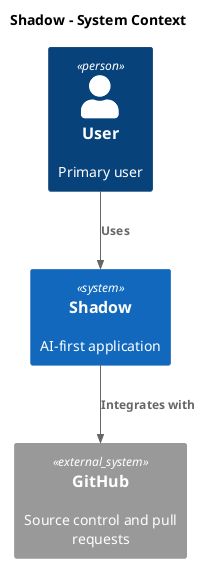

# Diagrams

Tämä hakemisto sisältää projektin versionhallittavat diagrammilähteet.

Diagrammien ensisijainen formaatti on PlantUML.

Poikkeus: ADR-015 hyväksyy LikeC4:n AI via MCP -ominaisuuden C4-mallin
työkaluksi. Sen lähteet ovat hakemistossa `docs/architecture/diagrams/likec4/` ja ohjeet
tiedostossa `docs/architecture/diagrams/likec4/README.md`.

Generoidut kuvat tallennetaan hakemistoon:

```text
docs/architecture/diagrams/generated/
```

---

# Diagram Rules

## Architecture Diagrams

Arkkitehtuurikuvat piirretään C4 frameworkilla käyttäen PlantUML:ää.

Käytä C4-tasoja:

- C4 Level 1: System Context
- C4 Level 2: Container
- C4 Level 3: Component
- C4 Level 4: Code, vain jos siitä on selkeä hyöty

Pidä C4-kuvat synkassa `docs/architecture/overview.md`:n ja ADR-dokumenttien kanssa.

## LikeC4

LikeC4 on sallittu vain AI via MCP -ominaisuuden C4-mallille (ADR-015):
`docs/architecture/diagrams/likec4/shadow-ai-mcp/`. Yksi malli tuottaa context-, container-,
component-, deployment- ja dynamic-näkymät. LikeC4 ajetaan `npx`:llä
versioon `likec4@1.60.0` pinnattuna, eikä se ole projektin riippuvuus.

Olemassa olevat PlantUML-kuvat pysyvät ennallaan, ja muut uudet diagrammit
tehdään edelleen PlantUML:llä, ellei uusi ADR toisin päätä.

## Domain And Concept Diagrams

Domain- ja concept-tason kuvissa saa käyttää myös muita PlantUML-kaaviotyyppejä, kun ne kuvaavat asiaa paremmin:

- state diagrams domain- tai concept-lifecycleen
- sequence diagrams cross-domain workflow'hin
- activity diagrams prosessikuvauksiin
- component diagrams domainien välisiin riippuvuuksiin

Domain-kuvien tulee vastata `docs/architecture/domains/`-dokumentaatiota.

## Mermaid

Mermaid on sallittu vain silloin, kun se on tarkoituksenmukaisempi kuin PlantUML.

Tällä hetkellä Mermaid `gitGraph` on sallittu Git-branchien visualisointiin, koska PlantUML:ssä ei ole vastaavaa natiivia gitGraph-kaaviota.

---

# Directory Layout

```text
docs/architecture/diagrams/
├── README.md
├── likec4/
│   ├── README.md
│   └── shadow-ai-mcp/*.c4
├── c4-l1-system-context-<scope>.puml
├── c4-l2-container-<scope>.puml
├── c4-l3-component-<scope>.puml
├── data-logical-model.puml
├── db-physical-schema.puml
├── state-<domain>-<concept>.puml
├── sequence-<workflow>.puml
└── generated/
    ├── c4-l1-system-context-<scope>.svg
    ├── c4-l2-container-<scope>.svg
    ├── c4-l3-component-<scope>.svg
    ├── data-logical-model.svg
    ├── db-physical-schema.svg
    ├── state-<domain>-<concept>.svg
    ├── sequence-<workflow>.svg
    └── likec4-<view>.png
```

---

# Naming Convention

Käytä lowercase kebab-case -nimiä.

## C4 Diagrams

```text
c4-l1-system-context-<scope>.puml
c4-l2-container-<scope>.puml
c4-l3-component-<scope>.puml
c4-l4-code-<scope>.puml
```

Esimerkkejä:

```text
c4-l1-system-context-shadow.puml
c4-l2-container-shadow.puml
c4-l3-component-customer-domain.puml
```

## Domain And Concept Diagrams

```text
domain-<domain>-overview.puml
state-<domain>-<concept>.puml
concept-<domain>-<concept>.puml
sequence-<workflow>.puml
activity-<workflow>.puml
```

Esimerkkejä:

```text
domain-customer-overview.puml
state-document-lifecycle.puml
concept-ai-extraction-result.puml
sequence-create-customer.puml
activity-ai-document-classification.puml
```

## Data And Database Diagrams

```text
data-logical-model.puml
db-physical-schema.puml
db-<domain>-schema.puml
```

Esimerkkejä:

```text
data-logical-model.puml
db-physical-schema.puml
db-customer-schema.puml
```

## Generated SVGs

Generoidun SVG:n nimi on sama kuin PlantUML-lähteen nimi:

```text
docs/architecture/diagrams/c4-l1-system-context-shadow.puml
docs/architecture/diagrams/generated/c4-l1-system-context-shadow.svg
```

Älä muokkaa generoituja SVG-tiedostoja käsin. Muokkaa `.puml`-lähdettä ja renderöi SVG uudelleen.

## LikeC4 Exports

LikeC4-näkymät exportataan PNG:ksi nimellä `likec4-<view>.png`, jossa
`<view>` on näkymän id:

```text
docs/architecture/diagrams/likec4/shadow-ai-mcp/views.c4   (view productionMcp)
docs/architecture/diagrams/generated/likec4-productionMcp.png
```

Älä muokkaa PNG:itä käsin. Komennot ovat tiedostossa
`docs/architecture/diagrams/likec4/README.md`.

---

# C4 PlantUML Template

Käytä C4-PlantUML-syntaksia, kun kuvaat C4-tasoja.

Esimerkki:



Jos PlantUML-ympäristö ei tue C4-kirjastoa suoraan, lisää projektiin tai renderöintiympäristöön tarvittava C4-PlantUML-tuki ennen diagrammin muuttamista.

---

# Rendering

Project diagrams can be rendered through the Docker Compose docs profile:

```bash
docker compose --profile docs build diagram-renderer
docker compose --profile docs run --rm diagram-renderer
```

By default, `diagram-renderer` renders:

```text
docs/architecture/diagrams/db-physical-schema.puml
```

to:

```text
docs/architecture/diagrams/generated/db-physical-schema.svg
```

Render the logical data model with an explicit source argument:

```bash
docker compose --profile docs run --rm diagram-renderer \
  -tsvg -o generated data-logical-model.puml
```

Jos paikallinen PlantUML-serveri on käytössä portissa `9000`, renderöi SVG:t serverin kautta.

Projektissa käytetty oletus:

```text
http://localhost:9000
```

Kun lisäät uuden diagrammin:

1. Luo `.puml` tiedostoon `docs/architecture/diagrams/`.
2. Renderöi vastaava `.svg` tiedostoon `docs/architecture/diagrams/generated/`.
3. Linkitä SVG Markdownista suhteellisella polulla.
4. Commitoi sekä `.puml` että `.svg`, jos SVG:tä käytetään dokumentaatiossa.
