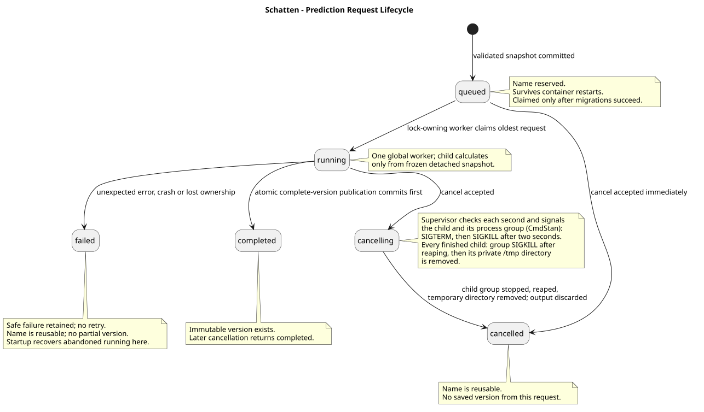

# Forecasting Domain

Status: durable request persistence, API, standalone worker, current-tab UI and
supported-runtime wiring implemented by TASK-057C/TASK-057D/TASK-057E;
ADR-014 Prophet result kind and per-version model selection backend
implemented by TASK-061B; Predictions UI pending TASK-061C

## Purpose

The Forecasting Domain produces and stores auditable, immutable predictions for
scenario metrics. It keeps derived model output distinct from manually entered
scenario timeseries values and does not change source scenario data.

## Responsibilities

Owns:

- prediction versions
- durable prediction requests and their immutable calculation snapshots
- target-metric prediction records
- per-model result metadata and eligibility states
- dated prediction points
- immutable modelling and source-input snapshots

Provides:

- named, comparable forecast versions for one organisation
- prediction-method provenance and cross-validation metadata
- version-selected prediction intervals for supported fitted-model results
- a clear distinction between manual scenario values and derived predictions

Does NOT Own:

- organisations
- scenarios, organisation states or events
- timeseries definitions or manually entered timeserie values
- graph nodes, graph edges, metamodels or graph attributes
- the existing Analysis workspace

## Domain Rules

### Scenario-Owned Observation Sources

Each selected target scenario supplies its own observed metric values. A target
metric needs no Reality counterpart, and Forecasting never reads, merges,
falls back to or imputes from Reality or another scenario's values. Reality is
an eligible target scenario and, when selected, uses only its own values.

Forecasting does not write into `timeserie_values` or turn derived predictions
into manual scenario values.

Derived metric targets are not model-fitted. Forecasting first creates normal
metric results, then evaluates a derived metric equation independently for each
matching result kind using its normal input result points. Missing, unavailable
or invalid inputs produce an ineligible derived result with saved provenance.

### Scenario-Isolated Explanatory Inputs

For a target scenario, Forecasting may use only that scenario's own known
events and graph history as explanatory inputs. It derives period-specific
event counts, active graph node/edge totals, type counts and target-metric
linked node counts. Graph visibility uses the Organisation Twin Structure
Domain's logical lifetime rules.

The domain never combines a target scenario's model inputs or values with any
other scenario's metric values, events or graph structure.

### Eligible Metrics And Date Grid

Only number-valued target timeseries are eligible. The target scenario's own
effective history must be contiguous on the matching metric time-unit grid; no
missing observation is interpolated or forward-filled. Non-numeric, incomplete
or insufficient metrics are normal ineligible states with a saved reason.

Prediction requests provide a start and end date. Each target metric produces
only the valid day, week, month or year starts that fall inside that inclusive
range. The request requires the start date to be earlier than the end date.

### Training Cutoff Modes

Each version records one selected observation cutoff mode:

- `asOfStart` uses only effective permitted observations strictly before the
  first predicted metric period. It supports non-leaking historical forecasts.
- `allCurrentScenario` uses all currently active target-scenario observations.
  A caller must disclose its future-knowledge risk for a past prediction range.

### Result Kinds

ADR-014 defines six result kinds. Every otherwise eligible target metric
attempts the result kinds selected for its version (see Model Selection):

| Kind | Meaning |
| --- | --- |
| MLForecast | Deterministic MLForecast using scikit-learn RandomForestRegressor, target lags, calendar features and known target-scenario inputs. |
| Naive | Repeats the latest eligible effective observation. |
| Seasonal naive | Repeats the effective observation one selected seasonal cycle ago. |
| Average | Uses the mean of effective observations available under the selected cutoff mode. |
| SARIMA | Statsmodels SARIMAX with the selected seasonal period and known target-scenario inputs. |
| Prophet | Meta's Prophet fitted with MAP and a fixed seed, with the known target-scenario inputs as regressors. |

Seasonality is automatically detected per metric using autocorrelation and
rolling-origin validation. If detection is inconclusive, a manual per-metric
seasonal period is required. Until one is supplied the target is not eligible,
so every selected result kind for it is ineligible. Seasonal-naive and SARIMA
use the period; the other kinds do not.

MLForecast cross-validation uses rolling origins when enough history supports
three validation windows. The result records MAE or an explicit unavailable
state. Forecasting persists every selected result kind rather than silently
selecting one winner.

Prophet (`prophet`, ADR-014):

- uses the target scenario's own history as `ds`/`y` and adds every known
  target-scenario feature as a regressor; features with zero variance in the
  training history are dropped, and future regressor values come from the
  prediction periods;
- sets seasonality by time unit: weekly only for `day`, yearly for `day`,
  `week` and `month`, and daily never; it does not use the seasonal period as
  a model parameter, but follows target-level eligibility like every kind;
- fits with MAP (`mcmc_samples=0`), `uncertainty_samples=1000` and the version
  seed, and resets NumPy's global random state to that seed before every
  prediction, so identical inputs give identical results;
- needs at least 12 contiguous observations, like MLForecast;
- records cross-validation MAE from three expanding one-step windows
  (`n_windows=3`, `h=1`), comparable with MLForecast; a window that cannot be
  fitted makes cross-validation `unavailable` and keeps the point result;
- records an `ineligible` result with a fixed safe reason on short history or
  an expected fit failure (a `ValueError`, or a `RuntimeError` raised by
  `cmdstanpy`), never exception text, without affecting other kinds or metrics
  in the version; and
- treats any other exception, including a missing dependency, as an
  unexpected calculation failure that fails the request (ADR-012).

### Model Selection

Each prediction request selects which result kinds its version calculates
(`modelKinds`):

- The selection is a non-empty list of supported result kinds without
  duplicates; invalid selections are rejected with a validation response.
- Omitting it selects all six kinds.
- One selection applies to every normal and derived target in the version.
- The selection is frozen into the request snapshot and recorded as
  `modelKinds` in the immutable version's model configuration.
- Only selected kinds are fitted and persisted; unselected kinds have no
  result rows and no "not selected" status.
- Derived targets evaluate their formulas for the selected kinds only.
- A queued snapshot from before ADR-014 that has no selection calculates the
  five legacy kinds, without Prophet. A saved version without `modelKinds`
  ran the kinds present in its results.

### Prediction Intervals

Each new prediction version records one user-selected integer prediction-
interval level from 50 through 99 percent; the default is 80 percent. The level
is selected before preflight and creation and applies to every supported result
in that immutable version. It expresses nominal coverage for a future observed
value, not guaranteed coverage and not a confidence interval around an
estimated mean.

Forecasting creates central, two-sided intervals only for directly fitted
normal-metric results:

- MLForecast uses conformal-error intervals with three one-step calibration
  windows (`n_windows=3`, `h=1`). The one-step calibration gives a constant
  interval width across the forecast horizon.
- SARIMA uses the fitted Statsmodels forecast result's native interval with
  `alpha = 1 - confidence_level / 100`.
- Prophet uses its native sampled interval (`yhat_lower`/`yhat_upper`) with
  `interval_width = confidence_level / 100`.

Naive, seasonal-naive and average baselines have point values only. Live Reality
is observed comparison data and has no prediction interval. Formula-derived
results also remain point-only, including their `mlforecast`, `sarima` and
`prophet` result kinds; the domain does not propagate source bounds through equations.

An interval state is `available`, `unavailable` or `not_applicable`. Directly
fitted MLForecast, SARIMA and Prophet results are unavailable when their point result is
ineligible or no complete bounds can be calculated. Baseline and formula-derived
results are not applicable. An available interval is complete: every result
point has finite bounds satisfying
`lower_bound <= point_value <= upper_bound`. Negative bounds are not clipped
because numeric metrics have no general non-negative invariant. A result never
stores only some of its bounds.

An expected calibration, extraction or validation failure preserves valid point
predictions and records the interval as unavailable with a safe reason. A
directly fitted point-model failure retains its existing ineligible status and
uses its safe model reason for the unavailable interval, while an unexpected
generation failure still rolls back the whole version.

No prediction data exists in production at the time of ADR-011. Its schema
migration may discard development prediction versions rather than backfilling
interval metadata or supporting a legacy display path.

### Versioning, Audit And Failures

A prediction version has an organisation-local, case-insensitively unique
name. Saved versions are immutable and cannot be overwritten; a new execution
needs a new name.

Every saved result retains creator and creation metadata, target identity,
cutoff mode, prediction-interval level and method where applicable, seasonal
period/source, deterministic model configuration and seed, validation
information, source-input snapshots including each effective observation
source, and result points. This keeps results auditable after source rows change
or are soft-deleted.

Expected limitations are stored per metric/model with a machine-readable
status and safe explanatory reason. They do not prevent other eligible
metrics/models from being stored in the same version. Unexpected generation
errors abort the version transaction and leave no partial version.

### Execution Requests And Bounds

The create route runs preparation synchronously but queues calculation through
three explicit boundaries. Preparation freezes one format-identified, Pydantic-
validated input snapshot in a PostgreSQL `REPEATABLE READ` transaction.
Calculation accepts only that serialized shape and returns detached results;
it has no Session or ORM input and performs no source reads, saved-version
writes or commits. Publication accepts the frozen input and detached output and
saves the complete immutable version in one transaction.

The snapshot contains stable scenario and metric identities and display
metadata, effective observations and provenance, historical/future feature
grids, eligibility, cutoff and seasonality selections, interval level,
selected result kinds, deterministic model configuration, creator attribution,
and derived formulas
with referenced metric keys and captured short names. Normal targets are
calculated before derived targets, whose formulas resolve only against the
detached normal results. Source edits, soft deletion and formula or short-name
changes after preparation therefore cannot change calculation or saved audit
provenance.

The API commits that snapshot in a queued request before returning
`202 Accepted`. A standalone lock-owning worker processes snapshots in global
submission order without changing model behavior or these bounds. It uses one
child process per request and keeps queue access and publication in the
supervisor. Under ADR-014 each child runs in its own process group, which the
supervisor stops as a whole so CmdStan processes stop with it, and uses a
private temporary directory that the supervisor removes after reaping it.

One request permits at most 50 numeric target scenario/metric candidates, 366
generated periods per pair, 10,000 contiguous
effective observations per pair, and 110,000 persisted prediction points across
the version (ADR-014). The point estimate counts only the selected result kinds;
the 110,000 limit admits every request within the candidate and period limits
with all six kinds selected. Detailed eligibility is evaluated only within the candidate bound.
A request that exceeds a limit is rejected rather than truncated.

## Database Ownership

Owned tables:

- prediction requests
- prediction versions
- prediction target metrics
- prediction model results
- prediction points

These tables are owned exclusively by Forecasting Domain. Other domains may be
read through their service boundaries but may not modify Forecasting-owned rows.
Target source identities are retained as stable-key snapshots rather than source
foreign keys, so saved versions remain readable when source rows are soft-deleted.

A request retains the submission-time detached snapshot, state, submitter,
cancellation actor, worker ownership, safe failure information and optional
completed-version reference. Requests are mutable history; versions are
immutable completed output. Active requests reserve a case-insensitive name per
organisation alongside completed versions; cancelled and failed requests release
their names. ADR-012 defines the queue, publication/cancellation race and
recovery contract.

## API Ownership

The organisation-scoped API exposes prediction preflight, queued creation and
saved-version list/detail. `POST /predictions` returns `202 Accepted`, a request
summary and a `Location` status URL after committing the frozen snapshot.
Request list/detail and idempotent cancellation are exposed under
`prediction-requests`; the list contains every active request plus the 50 most
recently finished. Existing saved-version list and detail contracts remain
unchanged. Mutation CSRF/Origin checks and actor attribution apply, and both
consultants and administrators may inspect/cancel another user's request.

## Dependencies

Depends On:

- Organisations Domain for organisation scope
- Organisation States Domain for scenarios, events and timeseries
- Organisation Twin Structure Domain for graph-history inputs
- Users Domain for audit actors

Referenced By:

- Predictions workspace UI planned in TASK-041C

## Common Workflow

### Background Request Workflow

1. Validate and freeze one complete detached input snapshot during submission.
2. Persist a queued request and return its `202 Accepted` summary.
3. The lock-owning worker claims the oldest queued request and calculates only
   from its snapshot in a supervised child process.
4. The supervisor atomically publishes a complete immutable version and marks
   the request completed, unless cancellation committed first.
5. Cancellation stops active child work promptly and discards partial output;
   failure records safe request history without a partial version.

In the current organisation's Predictions tab, users queue named work and can
continue submitting other uniquely named requests. The tab separates all active
requests from recent history, initially showing the three newest terminal
records. An accessible Show more / Show less control reveals the remainder of
the backend's newest-first history (up to 50), preserves expansion across polls,
and resets on organisation change. Every card shows browser-local queued,
processing-start and finish timestamps to minute precision, with explicit
Not started / Not finished stages. Queue and processing durations use completed
elapsed minutes, compact minute/hour/day units and a sub-minute label; ongoing
durations refresh with the existing poll. Never-started terminal work measures
queue time through its finish.

The tab polls summaries every two seconds while visible and lets either
business role remove queued work or stop
running work. Stopping never deletes saved output or request history. A completed
request refreshes the saved-version library; only a completion submitted from
that tab is automatically selected for comparison.

Each successful current-tab submission adds a separate, newest-first,
individually dismissible informational notice. Its accepted-and-queued text stays
while running or stopping, then changes once to completed, cancelled, or a danger
alert for failure with the server's safe reason when available. Unchanged polls
do not re-announce notices, and requests discovered through polling do not create
them. Notices last only for the mounted tab and organisation context; dismissal
is permanent within that context and does not stop saved-result selection.
Locally submitted active requests omitted from the capped list are resolved
through request detail within the same non-overlapping poll cycle. Completion
still refreshes and selects the saved version, including after notice dismissal.



### Generate A Prediction Version

1. In one consistent read snapshot, validate the organisation and selected
   active target scenarios, resolve metrics and history, construct scenario-
   isolated features, and freeze all model and audit inputs.
2. Serialize and validate the detached snapshot shape.
3. Calculate the selected normal result kinds from only the snapshot, then
   calculate derived results for the same kinds from the captured formulas,
   references and normal outputs.
4. Persist the immutable named version, result and interval metadata, points,
   available bounds and captured audit snapshots in one transaction.
5. Persist expected model and interval limitations as result state; roll back
   the entire publication on an unexpected persistence failure. An unexpected
   calculation failure occurs before publication and leaves no version rows.

## AI Agent Guidance

Before changing Forecasting behavior, read:

```text
docs/decisions/ADR-007-predictions-forecasting-domain.md
docs/decisions/ADR-008-target-scenario-observation-overrides.md
docs/decisions/ADR-009-scenario-owned-prediction-inputs.md
docs/decisions/ADR-010-derived-metrics.md
docs/decisions/ADR-011-prediction-intervals.md
docs/decisions/ADR-012-background-prediction-requests.md
docs/decisions/ADR-014-prophet-and-model-selection.md
docs/domains/FORECASTING.md
docs/domains/ORG_STATES.md
docs/domains/ORG_TWIN_STRUCTURE.md
docs/data/DATA-MODEL.md
docs/data/DATABASE.md
db/migrations/README.md
```

- Keep manual scenario values and derived prediction values in separate storage
  and presentation paths.
- Enforce source-data isolation in backend services; frontend selection is not
  the security boundary.
- ADR-012 permits only its specified single-worker queue; do not extend it to a
  general job platform, retries or parallel calculations.
- Keep accepted design documents distinct from implementation status until the
  corresponding TASK-057 work is complete.
